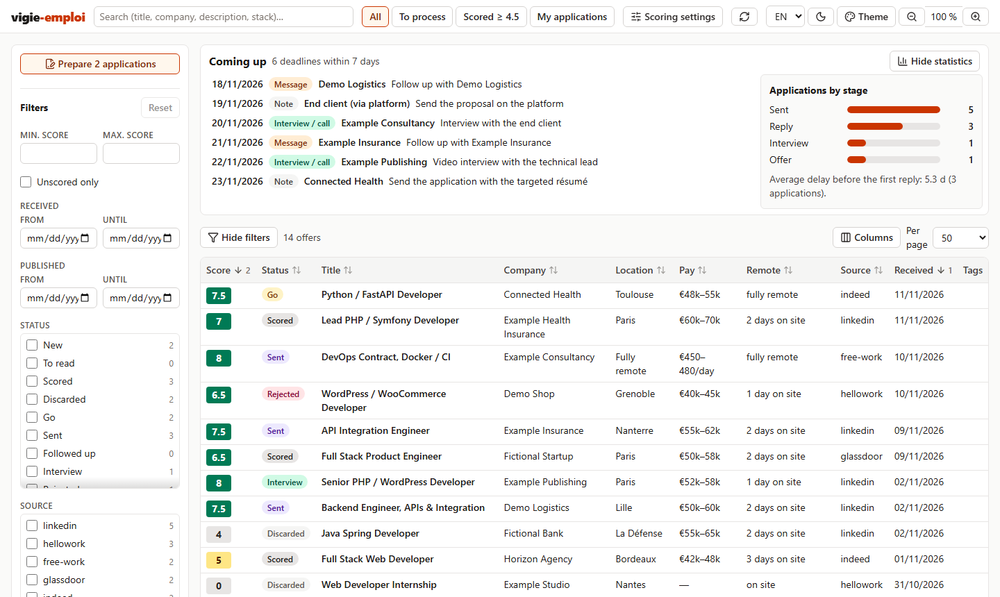
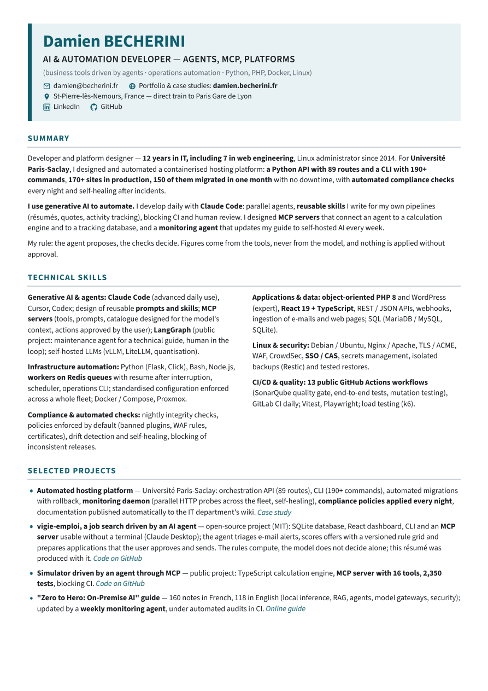
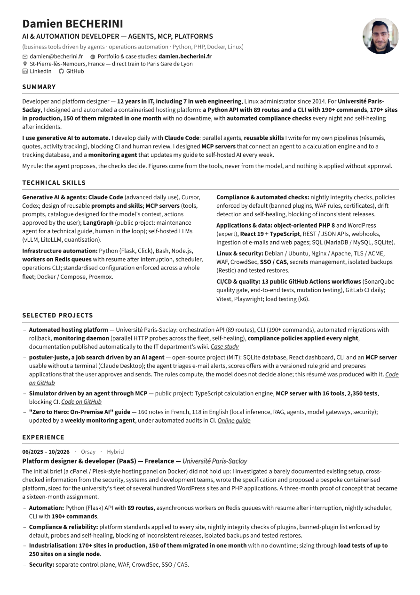

<div align="center">

# vigie-emploi

[Français](README.md) · **English**

**Your job or freelance search, driven by your AI, without ever making you lie.**

[](LICENSE)
[](https://nodejs.org)
[](https://www.typescriptlang.org)
[](https://nodejs.org/api/sqlite.html)
[](https://modelcontextprotocol.io)
[](#requirements)
[](#privacy)

</div>

---

vigie-emploi is a local kit to look for a permanent job or freelance assignments with an AI agent (Claude Code, Cursor, Codex…). The AI triages the offers you receive through e-mail alerts, scores each one with **your** grid, prepares the applications you approve (application file, tailored résumé, message) and keeps track of the follow-up. Everything stays on your computer.

> Everything is available in English with `init --language en`: the AI instructions and workspace templates (your agent works and writes in English: résumés, messages, application files), the sample scoring grid, the MCP server, the dashboard and the CLI messages. The language selector in the dashboard header switches the dashboard only. Command names and statuses are English identifiers; the workspace's file names stay in French.

The name means "job lookout" (*vigie*, the sailor in the crow's nest who spots what matters and calls it out). Two promises:

- **it sorts for you**: the alerts your mail client drops off are read in a single pass when you start the triage; a transparent, adjustable scoring grid (weights, pay floor, remote work, blocking rules) only shows you the offers worth your time; and every follow-up has its date;
- **it never makes you lie**: the AI relies on an inventory of what you can and cannot claim, built with you during onboarding. It only writes in a résumé what you can defend in an interview. Application after application, you refine with it what makes you valuable and the message you want to convey, until the result truly sounds like you.

## How it works

```
e-mail alerts (.eml)  →  triage and scoring by the AI (your grid)  →  your "go"
        →  application file + tailored résumé (PDF, 2 pages) + message  →  sent by you  →  follow-up (journal, deadlines, reminders)
```

1. **Guided onboarding**: you drop your résumé (and the PDF export of your LinkedIn profile) into `a-deposer/`. The AI reads them, looks at your public pages if it can, then asks you small batches of questions: targets, background, evidence, what sets you apart, risks, things never to claim, conditions. From this it writes your **context** (`_CONTEXTE.md`), your **grid** and a first **résumé**, which you approve.
2. **Alert triage**: a mail filter saves the alerts (LinkedIn, Indeed, Glassdoor, Hellowork, Free-Work…) into `emails/` (see [Automating alert intake](#automating-alert-intake)). The AI ingests them, discards off-target ones, scores the rest criterion by criterion (the application computes the score) and shows you the best offers.
3. **Applications**: on your "go", the AI prepares the application file, a tailored résumé that fits on two pages, and the message adapted to the form and its character limit. **You do the sending.**
4. **Follow-up**: you tell it what happened ("sent yesterday", "interview Thursday at 2 pm"); the AI keeps the journal, the deadlines and the tracking table.

The application **calls no AI model**: your agent reads and writes, the application keeps the state (SQLite database, web dashboard, CLI, MCP server).



*The dashboard (fictitious data): offers sorted by date received then by score, deadlines for the next seven days, applications by stage.*


*Offer details: each criterion, its sub-score, its weight and its contribution to the final score, with the AI's justification.*

### Résumés

Résumés are written in Markdown and rendered as two-page A4 PDFs, with three templates: "plain" (serif), "modern" (colour banner) and "compact" (single column, dense). The AI can also adapt the stylesheet to a model you show it.

<div align="center">
<a href="docs/exemples/CV-damien-becherini-plain.en.pdf"></a>
<a href="docs/exemples/CV-damien-becherini-modern.en.pdf"></a>
<a href="docs/exemples/CV-damien-becherini-compact.en.pdf"></a>

<em>My own résumé, written with vigie-emploi and rendered with each of the three templates (first page; click to open the full PDF). Markdown source: <a href="docs/exemples/CV-damien-becherini.en.md">docs/exemples/CV-damien-becherini.en.md</a>.</em>
</div>

## Requirements

- **Node.js 24** or later, except with the Claude Desktop extension (it uses the Node built into the application).
- **Chrome, Edge or Chromium** (for PDF résumés).
- **An AI**: Claude Desktop (one-click extension, nothing else to install), or an agent that works in a folder: Claude Code preferably (MCP server and skills included); Cursor, Codex or another agent read the same instructions (`AGENTS.md`) and use the CLI.
- Optional: a **browser driven by the AI** with your sessions (for example Claude in Chrome), to read LinkedIn, Indeed or Glassdoor offers. Without it, you paste the offer text when the AI asks.

## Getting started

### One-click install (Claude Desktop)

1. Download the `vigie-emploi-<version>.mcpb` file (the repository's [Releases](https://github.com/DamienBecherini/vigie-emploi/releases) page).
2. Double-click it (or drag it into the Claude Desktop window, or **Settings → Extensions → Advanced settings → Install Extension…**), then click **Install**.
3. Choose the **workspace folder** (by default `ma-recherche` in your home folder; it does not need to exist) and the **language**: type `en`.
4. In a new conversation, ask "create my vigie-emploi workspace", or **+** button → vigie-emploi → **`onboarding`** prompt. Claude creates the workspace, asks you to drop your résumé into `a-deposer/`, then runs the onboarding.

No terminal and no Node to install: the extension contains the application and uses the Node built into Claude Desktop. To browse your job ads in the dashboard, ask Claude to open it (`open_dashboard` tool). Details (in French): [docs/utiliser-avec-une-ia.md](docs/utiliser-avec-une-ia.md#claude-desktop).

### With Claude Code or another agent

```sh
npx vigie-emploi init ~/my-search --language en
```

Nothing to clone or build: npx downloads the application and runs `init`. The workspace remembers the version used (`npx -y vigie-emploi@<version>`, in `.mcp.json` and in the AI instructions). For a permanently installed command: `npm install -g vigie-emploi`, then `vigie-emploi init ~/my-search`. To contribute, install from the repository (see [Installation](#installation)).

`init` creates your workspace (`--template modern` or `compact` to change the résumé template; `--language en` for English AI instructions, grid, dashboard and CLI, French being the default) and prints the starting prompt to give your AI. Then:

1. drop your résumé into `~/my-search/a-deposer/`;
2. open your AI in `~/my-search` (Claude Code: `cd ~/my-search` then `claude`, and accept the MCP server);
3. paste the prompt printed by `init`.

Onboarding takes two sessions of about half an hour each.

## Automating alert intake

The AI processes the alerts found in the workspace's `emails/` folder, as `.eml` files. You can drag the e-mails there by hand from your mail client, but the simplest way is a filter that does it each time mail is fetched.

1. Create **alerts** on the job sites you use (LinkedIn, Indeed, Glassdoor, Hellowork, Free-Work…), with your keywords.
2. Set up your mail client to **save each alert received as an `.eml` file in `emails/`**, then move it to a separate folder.
3. Then ask your AI to "process the e-mails", or, with Claude Code, click "Process N e-mails" in the dashboard. Processed files are deleted from `emails/`.

### Example with Thunderbird and FiltaQuilla

Thunderbird cannot save a message as a file from a filter; the [FiltaQuilla](https://addons.thunderbird.net/thunderbird/addon/filtaquilla/) add-on adds this action.

**1. Install and configure FiltaQuilla**

- Menu **Tools → Add-ons and Themes**, search for "FiltaQuilla" and install the add-on.
- Open its **options** (Add-ons → FiltaQuilla → Options). In the list of actions, **enable "Save Message as File"**: it is disabled by default and does not appear in filters until it is.

**2. Create the filter**

- Menu **Tools → Message Filters**, choose the account that receives the alerts, then **New**.
- Name it, for example "Job alerts".
- Choose **"Match any of the following"** and add a condition **From → contains → the sending address of the alerts** for each site (open an alert you received to find it).
- Under **"Perform these actions"**:
  1. **Save Message as File**: choose the `emails/` folder of your workspace (for example `~/my-search/emails`);
  2. *(optional)* **Move Message to** a subfolder, for example "Processed alerts": you can then see in Thunderbird what has already been passed on.
- Let the filter run on **Getting New Mail**. For alerts already received: select the filter, then **Run Now** on the inbox.

With another mail client the idea is the same: any rule or script able to save a message as `.eml` into `emails/` will do.

## Privacy

Your workspace (résumés, context, database, applications) stays on your disk. Nothing is sent anywhere except to the AI you use. The application only downloads the public pages of Hellowork and Free-Work offers; it never reads LinkedIn, Indeed or Glassdoor by script.

## Reference

The rest of this document describes the application in detail: commands, configuration, grid, dashboard. Command names, statuses and options are the application's identifiers.

### Installation

Requirement: Node.js 24 or later (SQLite is built into Node through `node:sqlite`, nothing to compile).

From npm (the package contains the code compiled to JavaScript and the built interface):

```sh
npx vigie-emploi init ~/my-search    # without installing
npm install -g vigie-emploi          # or a permanently installed command
```

Command written by `init` into `.mcp.json` and into the workspace instructions:

- run through `npx`: `npx -y vigie-emploi@<version>` (on Windows, `cmd /c npx …` for the MCP server). The npx cache can be cleared, so its path is never written. The version is pinned so that the database and the application stay in sync; if needed, npx downloads it again (connection required). The application instructions (`AGENTS.md`, or `AGENTS.en.md` for an English workspace) are copied into `procedures/application.md`. To change versions, replace the number in `.mcp.json` and in the instructions, or switch to a global installation;
- installed (`npm install -g`, or from the repository): `node <path>/bin/vigie-emploi.js`, with the absolute path of the installation.

From the repository (contributors):

```sh
git clone https://github.com/DamienBecherini/vigie-emploi.git
cd vigie-emploi
npm install
npm run build      # type-checks, compiles src/ into dist/ and the interface into dist/ui
npm link           # makes the `vigie-emploi` command available everywhere (optional)
```

Without `npm link`, replace `vigie-emploi` with `node <path>/bin/vigie-emploi.js`. In the repository, `bin/vigie-emploi.js` runs the TypeScript in `src/` directly; without `src/` (npm package), it loads the compiled JavaScript from `dist/`, because Node refuses to run TypeScript located under `node_modules`. `npm pack` and `npm publish` rebuild everything (`prepack`).

Working names from before publication (`postuler-juste`, `cap-emploi`): their `POSTULER_JUSTE_*` / `CAP_EMPLOI_*` variables, `*.config.json` files and `data/*.sqlite` databases are still recognised, after the vigie-emploi ones.

### Creating your workspace

```sh
vigie-emploi init <folder> [--port 4410] [--mcp-name vigie-emploi] [--language fr|en]
```

The folder must be new or empty. `init` copies the workspace template into it (`scaffold/`, or `scaffold-en/` in English: AI instructions, context to fill in, guided onboarding, `a-deposer/` folder, application file template), the résumé template (`templates/cv/plain/`) and the sample grid, then writes `vigie-emploi.config.json` and `.mcp.json` (MCP server started with this data folder). It checks that Chrome, Edge or Chromium is available for PDFs, and prints the starting prompt to give the AI.

To try it without touching an existing installation: another folder, another port and another MCP server name (`--port 4411 --mcp-name vigie-emploi-test`).

### With Claude Desktop or another MCP client

The MCP server (`vigie-emploi mcp`) is enough for an AI with no access to your files and no terminal, such as Claude Desktop: it creates the workspace (`initialize_workspace`), provides the instructions as prompts (`onboarding`, `process-emails`, `prepare-go`, `targeted-cv`), reads the documents you drop in, writes the context, application files and résumés, generates the PDFs and starts the dashboard (`open_dashboard`). With Claude Desktop, the simplest route is the `.mcpb` extension ([One-click install](#one-click-install-claude-desktop)); you can also declare the server by hand in `claude_desktop_config.json`, with your workspace folder in `VIGIE_EMPLOI_DATA` and `VIGIE_EMPLOI_LANGUAGE` set to `en`. Details: [docs/utiliser-avec-une-ia.md](docs/utiliser-avec-une-ia.md#claude-desktop).

Building the extension (for a GitHub release): `npm run mcpb` builds the application, prepares `build/mcpb/vigie-emploi/` (compiled JavaScript, interface, templates, production `node_modules` only), validates `mcpb/manifest.json` and packs everything into `build/vigie-emploi-<version>.mcpb` (about 5 MB) with the official `@anthropic-ai/mcpb` tool. Attach that file to the release.

### PDF résumés

```sh
vigie-emploi cv "cv/<name>.md" [--template <folder>]
```

Converts a Markdown résumé into an A4 PDF (headless Chrome, Edge or Chromium; `VIGIE_EMPLOI_BROWSER` to force a path), written next to the `.md`, and prints the page count (target: 2). The template is a folder (`gabarit.css`, fonts, optional `portrait.jpg|png|webp`): `--template`, otherwise the workspace's `cv/gabarit/`, otherwise the application's. The expected Markdown structure is described in `scaffold-en/cv/LISEZMOI.md` (French: `scaffold/cv/LISEZMOI.md`).

### Data folder configuration

The data folder holds the database and the inbox:

```
<folder>/
  data/vigie-emploi.sqlite   database (created on first run)
  emails/                    .eml files to ingest (deleted once processed)
  candidatures/              optional history to import (see import-history)
  profil/grille.json         scoring grid (vigie-emploi rubric --init copies the sample)
```

To designate it, in order of precedence:

1. the `--data <folder>` option on each command;
2. the `VIGIE_EMPLOI_DATA` environment variable;
3. a `vigie-emploi.config.json` file (not versioned) in the current folder, in the data folder or at the application root. Template: [`vigie-emploi.config.example.json`](vigie-emploi.config.example.json).

| Key | Role | Default |
|---|---|---|
| `dataDir` | Data folder (absolute path or relative to the file) | — |
| `database` | Database path | `<data>/data/vigie-emploi.sqlite` |
| `emails` | Inbox | `<data>/emails` |
| `port` | Dashboard port | `4410` |
| `fetchJsonLd` | Read Hellowork / Free-Work pages | `true` |
| `excludedTitles` | Regular expressions (case-insensitive): titles discarded without reading | `[]` |
| `rejectedEmployers` | Regular expressions: refused employers (title, company, start of description) | `[]` |
| `terminal` | Command opening a terminal with the agent (dashboard buttons); `{folder}` and `{prompt}` are substituted | Windows: `["wt.exe", "-d", "{folder}", "claude", "{prompt}"]`; elsewhere: none |
| `language` | Language of the dashboard, the CLI messages, the MCP server texts shown to the user (what only the AI reads is in English) and the generated tracking file: `fr` or `en` (written by `init --language`, which also picks the language of the AI instructions); the selector in the dashboard header takes precedence, for that browser. Another language can be added without touching the logic: [docs/ajouter-une-langue.md](docs/ajouter-une-langue.md) (in French) | `fr` |

Environment variables also recognised: `VIGIE_EMPLOI_CONFIG` (config file), `VIGIE_EMPLOI_DATABASE` (database), `VIGIE_EMPLOI_PORT`, `VIGIE_EMPLOI_LANGUAGE`.

### Commands

All commands accept `--json` (stable output for an AI), `--data` and `--config`. `vigie-emploi --help` gives the full list.

| Command | Effect |
|---|---|
| `vigie-emploi ingest [--keep] [--no-fetch] [--emails <folder>]` | Reads the `.eml` files, adds new offers (`new`, or `dismissed` with the reason for excluded titles), then **deletes the processed e-mails** (unless `--keep`). Summary: new, duplicates, discarded, to read |
| `vigie-emploi import-history` | Imports `candidatures/_lots/*.json`, `candidatures/_ecartees.md`, `candidatures/_SUIVI.md` and the "Suivi" sections of `candidatures/*/dossier-candidature.md` (journal, see below); read-only, idempotent, with a report of unrecognised lines. A `_SUIVI.md` generated by vigie-emploi is not re-read |
| `vigie-emploi list [filters]` | Paginated list: `--status a,b`, `--score-min`, `--score-max`, `--unscored`, `--source`, `--tag`, `--from` / `--until` (received), `--text`, `--contract`, `--remote`, `--applications`, `--page`, `--size`, `--sort`, `--order`; multi-level sort: `--sort received_at:desc,score:desc` |
| `vigie-emploi show <id>` | Details: description, scores, status history, tags, application |
| `vigie-emploi to-read [--limit N] [--full]` | Offers to process without a score, with the URL to read, or the description already extracted |
| `vigie-emploi score <id> --json '{…}'` | Records a score for an offer |
| `vigie-emploi score --file lot.json [--dry-run]` | Records a batch of scores (offers found by `id` or `url`, created if needed); `--dry-run` computes without saving |
| `vigie-emploi rubric [--instructions]` | Current scoring grid: criteria and weights, scales, rules, inventory, examples (`--instructions`: instructions for the AI) |
| `vigie-emploi rubric --update '{…}' --summary "…" [--dry-run]` | Partial change (weights, threshold, scales, rules, inventory); new version and re-scoring, or preview with `--dry-run` |
| `vigie-emploi rubric --history` / `--version N` / `--restore N` / `--init` | Grid versions, restoring a version, copying the sample grid |
| `vigie-emploi rescore` | Recomputes criterion-based scores with the current grid |
| `vigie-emploi status <id> <status> [--comment "…"]` | Changes the status (with history) |
| `vigie-emploi tag <id> +add -remove` | Adds / removes tags |
| `vigie-emploi apply <id>` | Moves the offer to `go` and shows what is needed to prepare the application |
| `vigie-emploi application <id> [--folder] [--cv] [--channel] [--sent-at] [--message] [--next-action]` | Records the application (`""` clears a field); with `--sent-at`, the offer moves to `sent` |
| `vigie-emploi next-action <id> "text"` | Next action of the application (`-` to clear it) |
| `vigie-emploi link <id> <url or ->` | Offer link |
| `vigie-emploi event <id> --type <type> [--at "DD/MM/YYYY HH:MM"] --summary "…" [--direction sent\|received] [--channel] [--contacts] [--details] [--amount 3000 --unit "€ HT"] [--days 6] [--file <path>]… [--done\|--no-done]` | Adds an event to the journal (types: `message`, `interview`, `test`, `proposal`, `decision`, `note`). `--at`: DD/MM/YYYY, YYYY-MM-DD, optional time, `tomorrow`, `+3`; defaults to now. Dated in the future, it is not done: it is a deadline |
| `vigie-emploi journal <id>` | Application journal: deadlines first (overdue on top), then newest to oldest |
| `vigie-emploi deadlines [--days 7]` | Overdue deadlines and those in the next N days, across all offers |
| `vigie-emploi done <event_id> [--no-done]` | Marks a deadline as done (or reopens it) |
| `vigie-emploi files <id>` | Files of the application folder (paths to cite in `--file`) |
| `vigie-emploi stats` | Applications by stage (sent, reply, interview, offer) and average delay before the first reply |
| `vigie-emploi generate-tracker [--output <file>] [--replace]` | Generates the application tracking table from the database: `candidatures/_SUIVI.genere.md` by default (preview), `candidatures/_SUIVI.md` with `--replace` |
| `vigie-emploi mcp` | MCP server (stdio) for an AI |
| `vigie-emploi serve [--port 4410] [--idle <minutes>]` | Starts the dashboard on http://localhost:4410; with `--idle`, it stops by itself after that long without a visit (`GET /api/health` gives the remaining time) |

Statuses: `new`, `to-read`, `scored`, `dismissed`, `go`, `sent`, `followed-up`, `interview`, `rejected`, `closed`, `withdrawn`. "My applications" groups `sent` and the statuses after it.

Score format (the batch format):

```json
{
  "source": "linkedin", "url": "https://www.linkedin.com/jobs/view/1234567890/",
  "title": "…", "company": "…", "location": "…", "contract": "Permanent", "compensation": "€50k–60k",
  "remote": "hybrid", "published": "NC", "stack": "PHP, API",
  "criteria": {
    "technique": { "score": 8, "justification": "PHP, REST API; gap: PostgreSQL" },
    "role": { "score": 7, "justification": "…" },
    "interet": { "score": 6, "justification": "…" },
    "risque": { "score": 7, "justification": "…" }
  },
  "inputs": { "onsite_days": 2, "salary_min": 55000, "salary_max": 65000, "unit": "year" },
  "blockers": [],
  "fit": "…", "gaps": "…", "read": true
}
```

With `criteria` (or `inputs`, `blockers`), the score is **computed** with the grid; a `score` field, if provided, is ignored and reported in `warnings`. The response contains the score, the exact value and the breakdown. Without `criteria`, it is an overall score from the old grid (`score`, `raw_score`, `penalties`), which stays frozen. Optional fields: `id` (instead of `url`), `description`, `tags`. Descriptive fields only fill in what is missing; the latest score prevails. `NC` (not stated), like an empty value, means unknown.

### Scoring grid

The grid lives in `<data>/profil/grille.json` (generic template: [`examples/rubric.json`](examples/rubric.json), copied by `vigie-emploi rubric --init`). It contains:

- **weighted criteria** (7 at most) scored from 0 to 10: by the AI (`source: "ai"`, with an instruction in `description`) or by the application (`source: "computation"`, `computation: "remote"` or `"compensation"`); relative weights, normalised to 100%;
- **scales**: remote work (sub-score for 0 to 5 days on site, "unknown" value); pay (salary in K€/year and day rate in €/day: floor = 5, high target = 10, below the floor = 0, linear in between; optional full-remote floor; middle, low or high end of the range);
- **blocking rules**: identifier, label, effect `zero` or `cap` (with its value), active or not;
- **skills inventory** (technology → strong / medium / light / none), read by the AI for the technical criterion;
- **"worth a look" threshold** (quick view "Scored ≥ …");
- **reference examples** (offers scored criterion by criterion, with justification) to calibrate the AI;
- general **instructions** for the AI.

Computation: weighted average of the sub-scores → blocking rules (zero, cap) → rounded to the half point for display and filters (the exact value is kept). Missing data (criterion not scored, remote work or salary unknown): neutral value 5 and a **flag** on the offer. Days on site and salary come from `inputs`, otherwise from the offer's remote-work and pay fields.

Each save (panel, CLI, MCP, or file edited by hand) creates a **version** (number, date, author, summary) and **recomputes all criterion-based scores**, without re-reading any offer. Old overall scores stay as they are ("old grid" badge). You can go back to a previous version (it becomes a new version).

### Dashboard

`vigie-emploi serve`, then http://localhost:4410 (listens on 127.0.0.1 only). `--idle <minutes>` stops it after a period without activity.

Without a terminal (Claude Desktop): ask the AI to open the dashboard. The `open_dashboard` MCP tool starts it in the background if it is not already running (a separate process that survives an MCP server restart and stops after 60 minutes without activity), on the workspace's port or the next free one, and returns the address to click; `open: true` opens it in the default browser. It needs an installed `node` (24 or later); otherwise it runs inside the MCP server process, as long as Claude Desktop stays open.

- Server-side paginated table (25 to 500 rows per page), Thunderbird-style column sorting (the last header clicked becomes the primary sort, the previous one becomes secondary: click Score then Received to sort by date, then by score for equal dates; the URL keeps the levels), hideable columns.
- Filters: score, received and published dates, source, status, contract, remote work, tags, full-text search (accent-insensitive). Filters live in the URL: you can bookmark it.
- Quick views: to process, scored ≥ grid threshold (4.5 by default), my applications.
- **Scoring settings** (header button): weight sliders (normalised total shown), threshold, remote-work and pay scales, blocking rules (enable, effect, cap, add, delete), inventory (add, edit, delete, filter), reference examples recomputed live; **preview before saving** (offers whose score changes, offers crossing the threshold, clickable); mandatory change summary; version history and restore.
- **Work for the agent**, above the filters, only when there is some: "Process N e-mails" (`.eml` files waiting in the inbox) and "Prepare N applications" (offers in `go` without a folder). Each button opens a terminal in the data folder with the agent and the `/traiter-emails` or `/preparer-go` command (provided by the data folder, for example as Claude Code skills); the rest happens in that terminal. See [ADR 0005](docs/adr/0005-boutons-agent-et-notifications.md).
- **Live updates**: the server notifies the page (Server-Sent Events, `/api/stream`) when the database changes, whatever the origin of the write (CLI, agent, another tab), and when the inbox changes; the page then reloads its data. The "Refresh the data" button remains available.
- **Coming up** banner above the table: overdue deadlines and those in the next 7 days, each opening its offer; **Statistics** button (applications by stage, reply delay).
- Details panel: description, link to the offer (editable), **score breakdown** (criterion by criterion: sub-score, weight, contribution, justification, origin; rules applied; flags; exact value and grid version), "old grid" badge for an overall score, **sub-score correction** (AI criteria, days on site, salary, rules; the score is recomputed and added to the history), old-style overall score, **application** (next action, sending date, channel), **journal** (deadlines first, overdue in red; add, edit, delete an event, mark a deadline as done; link a file from the folder chosen from a list), **folder files** (links that open them), status history, editable tags, status change, **Apply** button (copies `apply <id>` to the clipboard and moves the offer to `go`).
- Files: served read-only through `/api/file/<path>`, only inside the data folder (no `..`, no hidden files, neither `data/` nor `emails/`, symbolic links resolved); Markdown rendered as simple HTML without scripts (CSP), `?raw=1` for raw text, PDFs and images as they are. The server rejects requests whose host is not `localhost` / `127.0.0.1`, and writes coming from another origin (non-local `Origin` header or `Sec-Fetch-Site: cross-site`).
- Language (header selector), light / dark / system theme and palettes, text size (remembered in the browser), keyboard navigation (Enter opens an offer, Escape closes the panel). On a phone, the filters open in a drawer.

Interface development: `vigie-emploi serve` on one side, `npm run dev:ui` on the other (Vite on http://localhost:5173, the API is proxied to port 4410; `VIGIE_EMPLOI_API` to change it).

### Generated application tracking

`vigie-emploi generate-tracker` writes the tracking table in Markdown (`candidatures/_SUIVI.md`), readable without the application, in the workspace language: sections **In progress** (to send first, then from the latest sending to the oldest), **Sent without reply** (status "no news" or "no reply"), **Closed** (refused, abandoned, closed), columns Offer, Type, Channel, Sent, Status, Next action, Folder, links to the folders. At the top: "File generated by vigie-emploi on …: do not edit by hand".

Next action column: the next deadline in the journal ("**04/11**: Follow up", "(overdue)" if the date has passed), otherwise the `next_action` field.

The database prevails: the file is regenerated, never read back. If you import an existing Markdown tracking file (`import-history`), as long as an imported application has not changed, its cells are rewritten as they were; the next action entered in the interface, the CLI or through MCP is never overwritten by a new import. Before replacing an old `_SUIVI.md`, compare it with the `_SUIVI.genere.md` preview.

### Journal and deadlines

**The database knows what happened and when; the Markdown folder keeps the documents.** An event has a type, a date (or date-time), a summary, and if needed: direction (sent / received), channel, contacts, amount + unit, days, details, files (paths relative to the data folder). A future date not done is a deadline; past and not done, it is overdue.

Import (`import-history`): the "Suivi" sections of active folders (`candidatures/*/dossier-candidature.md`, not `_archives/`) become events with origin `import`: Date | Event table rows, dated bullets "- 13/10/2026 — …", dated checked boxes "- [x] Envoyée le : 13/10/2026". Unchecked boxes (to do) are not imported. Guessed type (message, interview, test, proposal, decision; `note` by default, listed in the report); relative Markdown links and backticked paths to existing files become linked files. Idempotent: one fingerprint per line; a line removed from the folder removes the imported event if it has not been modified since. A line already entered by hand (CLI, MCP, dashboard: same offer, same type, same day, compatible direction) is not imported, so that a new import does not duplicate the journal; the report counts them. A folder that no application points to is attached to the application without a folder whose company appears in its name (if unique).

An offer already being followed (`go` and beyond) seen again in an e-mail alert, a scored batch or the register no longer changes status; the alert leaves a trace in the journal ("Seen again on …", one per day).

### Development

```sh
npm test            # Vitest (fictitious fixtures in tests/fixtures)
npm run typecheck   # TypeScript (server + interface)
npm run build       # typecheck + interface build
npm run mcpb        # Claude Desktop extension: build/vigie-emploi-<version>.mcpb
```

README screenshots and sample résumés (fictitious data, French and English):

```sh
node scripts/demo/demo.ts ../demo-en en                  # demo workspace (14 offers, applications, deadlines)
node scripts/demo/captures.mjs ../demo-en en             # docs/captures/tableau-de-bord.en.png, detail-offre.en.png (after npm run build)
bash scripts/demo/cv-exemples.sh                         # docs/exemples/*.pdf and docs/captures/cv-*.png (needs pypdfium2)
```

Layout:

```
bin/vigie-emploi.js   command entry point (TypeScript from src/ in the repository, JavaScript from dist/ in the npm package)
migrations/           versioned SQL schema (PRAGMA user_version)
src/core/             configuration, links, normalisation, offer operations, queries,
                      scoring grid (rubric.ts: pure schema and computation; rubric-storage.ts: file, versions, re-scoring)
src/db/               database opening and migrations
src/ingest/           .eml reading, JSON-LD, ingestion
src/import/           import of a Markdown / JSON history (including folder journals)
src/cli/              commands
src/api/              HTTP server (Hono): JSON API, data folder file reading, built interface
src/mcp/              MCP server (stdio), tools wired to src/core; texts in src/mcp/i18n/
src/cv/               Markdown résumé → PDF (headless Chrome), templates, page count
src/init/             workspace creation
src/i18n/             translation mechanism and texts of the CLI, the API and the tracking file
src/export/           application tracking generation (Markdown)
ui/                   React 19 + Vite + Tailwind CSS v4 + TanStack Table / Query interface (texts in ui/src/i18n/)
scaffold/, scaffold-en/   workspace template copied by init (AI instructions, onboarding, sample résumé)
templates/cv/          résumé templates ("plain", "modern", "compact")
examples/             sample scoring grids (French and English)
mcpb/, scripts/       Claude Desktop extension (manifest, build); scripts/demo/: demo workspace, screenshots, sample résumés
docs/adr/             architecture decisions (in French)
```

See also [`AGENTS.en.md`](AGENTS.en.md) (how an AI drives the application; French original: [`AGENTS.md`](AGENTS.md)), [`docs/utiliser-avec-une-ia.md`](docs/utiliser-avec-une-ia.md) (connecting the MCP server), [`docs/ajouter-une-langue.md`](docs/ajouter-une-langue.md) (adding a language) and the architecture decisions in [`docs/adr/`](docs/adr/) (all in French).

## License

Code under the MIT license (see `LICENSE`). Résumé template fonts under the SIL Open Font License: Amiri ("plain" template) and Source Sans 3 ("modern" and "compact" templates); license text in each template's `fonts/` folder.
