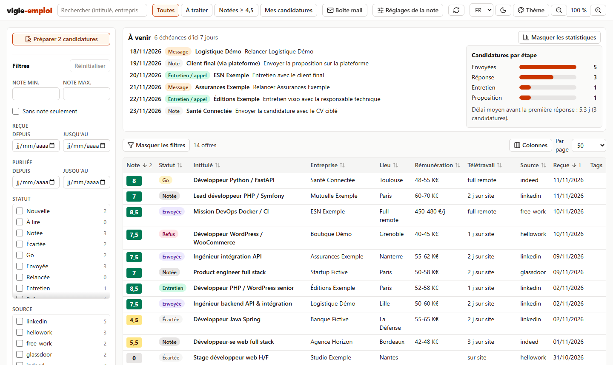
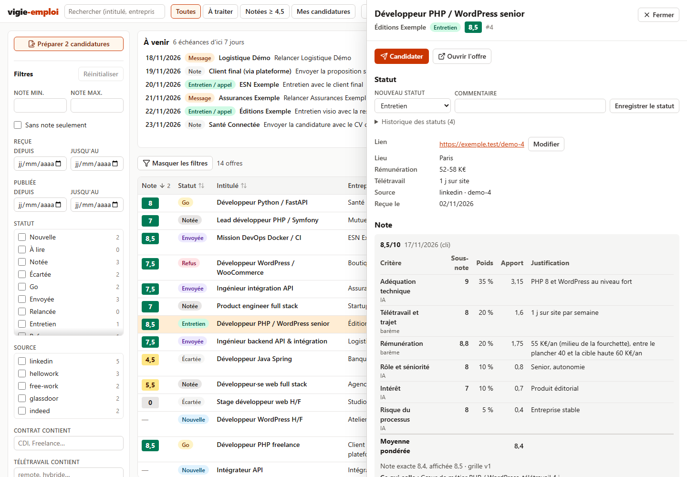
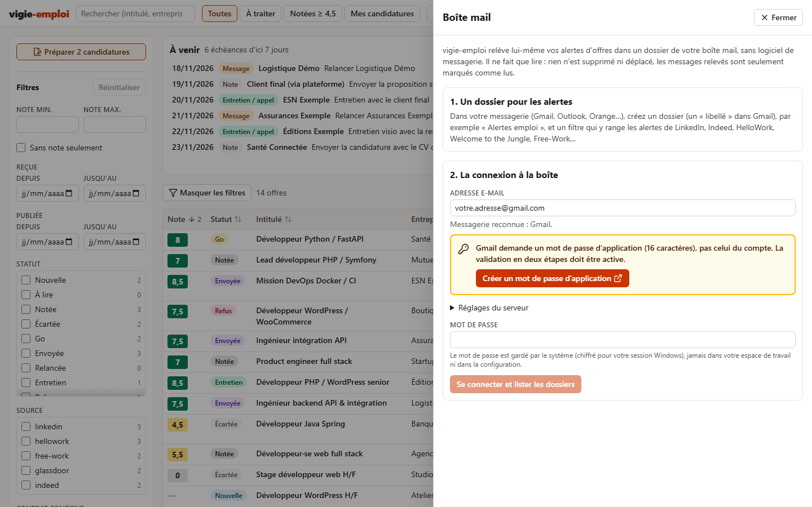

<div align="center">

# vigie-emploi

[English](README.md) · **Français**

**Votre recherche d'emploi ou de missions, pilotée par votre IA, sans jamais vous faire mentir.**

[](LICENSE)
[](https://nodejs.org)
[](https://www.typescriptlang.org)
[](https://nodejs.org/api/sqlite.html)
[](https://modelcontextprotocol.io)
[](#ce-quil-faut)
[](#confidentialité)

</div>

---

vigie-emploi est un kit local pour chercher un CDI ou des missions freelance avec un agent IA (Claude Code, Cursor, Codex…). L'IA trie les offres reçues par alertes e-mail, note chacune avec **votre** grille, prépare les candidatures que vous validez (dossier, CV ciblé, message) et tient le suivi. Tout reste sur votre ordinateur.

Une vigie, c'est le guetteur en haut du mât : il repère ce qui compte et le signale. Deux promesses :

- **elle trie pour vous** : les alertes d'offres de votre boîte mail sont relevées et lues d'un seul passage quand vous lancez le tri, une grille de notation transparente et réglable (poids, plancher de rémunération, télétravail, règles bloquantes) ne vous présente que les offres qui valent le coup, et chaque relance a sa date ;
- **elle ne vous fait jamais mentir** : l'IA s'appuie sur un inventaire de ce que vous pouvez revendiquer ou non, construit avec vous au démarrage. Elle n'écrit dans un CV que ce que vous pouvez défendre en entretien. Au fil des candidatures, vous affinez avec elle ce qui fait votre valeur et le message que vous voulez faire passer, jusqu'à ce que le résultat vous ressemble vraiment.

## Comment ça marche

```
alertes e-mail (.eml)  →  tri et notation par l'IA (votre grille)  →  vos « go »
        →  dossier + CV ciblé (PDF, 2 pages) + message  →  envoi par vous  →  suivi (journal, échéances, relances)
```

1. **Démarrage guidé** : vous déposez votre CV (et l'export PDF de votre profil LinkedIn) dans `a-deposer/`. L'IA les lit, consulte vos pages publiques si elle le peut, puis vous interroge par petits groupes de questions : cibles, parcours, preuves, ce qui vous distingue, risques, interdits, conditions. Elle en tire votre **contexte** (`_CONTEXTE.md`), votre **grille** et un premier **CV**, que vous validez.
2. **Tri des alertes** : un filtre de votre messagerie range les alertes (LinkedIn, Indeed, Glassdoor, Hellowork, Free-Work…) dans un dossier que l'application relève elle-même (voir [Automatiser la réception des alertes](#automatiser-la-réception-des-alertes)). L'IA les ingère, écarte le hors-cible, note le reste critère par critère (l'application calcule la note) et vous présente les meilleures offres.
3. **Candidatures** : sur votre « go », l'IA prépare le dossier, un CV ciblé qui tient en deux pages et le message adapté au formulaire et à sa limite de caractères. **C'est vous qui envoyez.**
4. **Suivi** : vous racontez (« envoyé hier », « entretien jeudi à 14 h ») ; l'IA tient le journal, les échéances et le tableau de suivi.

L'application **n'appelle aucun modèle d'IA** : c'est votre agent qui lit et rédige, l'application garde l'état (base SQLite, tableau de bord web, CLI, serveur MCP).



*Le tableau de bord (données fictives) : offres triées par date de réception puis par note, échéances des sept prochains jours, candidatures par étape.*



*Le détail d'une offre : chaque critère, sa sous-note, son poids et son apport à la note finale, avec la justification de l'IA.*

### Les CV

Les CV s'écrivent en Markdown et sortent en PDF A4 de deux pages, avec trois gabarits fournis : `plain` (sobre, à empattements), `modern` (bandeau de couleur) et `compact` (une colonne, dense). L'IA peut aussi adapter la feuille de style à un modèle que vous lui montrez.

<div align="center">
<a href="docs/examples/CV-damien-becherini-plain.fr.pdf"></a>
<a href="docs/examples/CV-damien-becherini-modern.fr.pdf"></a>
<a href="docs/examples/CV-damien-becherini-compact.fr.pdf"></a>

<em>Mon propre CV, écrit avec vigie-emploi et rendu avec chacun des trois gabarits (première page ; cliquez pour ouvrir le PDF complet). Source Markdown : <a href="docs/examples/CV-damien-becherini.fr.md">docs/examples/CV-damien-becherini.fr.md</a>.</em>
</div>

## Ce qu'il faut

- **Node.js 24** ou plus, sauf avec l'extension Claude Desktop (elle utilise le Node intégré à l'application).
- **Chrome, Edge ou Chromium** (pour les CV en PDF).
- **Une IA** : Claude Desktop (extension en un clic, rien d'autre à installer), ou un agent qui travaille dans un dossier : Claude Code de préférence (serveur MCP et skills fournis) ; Cursor, Codex ou un autre agent lisent les mêmes consignes (`AGENTS.md`) et utilisent la CLI.
- Facultatif : un **navigateur piloté par l'IA** avec vos sessions (par exemple Claude in Chrome), pour lire les offres LinkedIn, Indeed ou Glassdoor. Sans lui, vous collez le texte des offres quand l'IA le demande.

## Démarrer

### Installation en un clic (Claude Desktop)

1. Téléchargez le fichier `vigie-emploi-<version>.mcpb` (page [Releases](https://github.com/DamienBecherini/vigie-emploi/releases) du dépôt).
2. Double-cliquez dessus (ou glissez-le dans la fenêtre de Claude Desktop, ou **Paramètres → Extensions → Paramètres avancés → Installer une extension…**), puis cliquez sur **Installer**.
3. Choisissez le **dossier de l'espace** (par défaut `vigie-emploi` dans votre dossier personnel ; il n'a pas besoin d'exister) et la **langue** : `fr` ou `en` (laissée vide, c'est celle de votre système).
4. Dans une nouvelle conversation, demandez « crée mon espace vigie-emploi », ou bouton **+** → vigie-emploi → prompt **`onboarding`**. Claude crée l'espace, vous demande de déposer votre CV dans `a-deposer/`, puis mène le démarrage.

Pas de terminal ni de Node à installer : l'extension contient l'application et utilise le Node intégré à Claude Desktop. Pour parcourir vos offres dans le tableau de bord, demandez à Claude de l'ouvrir (outil `open_dashboard`). Détails : [docs/mcp.fr.md](docs/mcp.fr.md#claude-desktop).

### Avec Claude Code ou un autre agent

Ouvrez Claude Code (ou votre agent) dans n'importe quel dossier et collez ce prompt, sans rien modifier :

```text
Installe vigie-emploi pour ma recherche d'emploi (https://github.com/DamienBecherini/vigie-emploi) : lance « npx -y vigie-emploi@latest init », qui crée le dossier vigie-emploi dans mon dossier personnel, puis lis AGENTS.md et DEMARRAGE.md dans ce dossier et mène le démarrage avec moi. S'il manque Node.js 24, explique-moi comment l'installer.
```

L'agent crée votre espace de travail dans `~/vigie-emploi` (votre dossier personnel, sur Windows, macOS et Linux), puis commence le démarrage : il vous demande de déposer votre CV dans `~/vigie-emploi/a-deposer/` et vous pose ses questions. Pour un autre dossier, ajoutez son chemin à la fin de la commande dans le prompt (`… init D:/recherche`). Le démarrage se fait en deux sessions d'environ une demi-heure chacune ; pour la seconde et les suivantes, ouvrez Claude Code dans le dossier de l'espace (`cd ~/vigie-emploi` puis `claude`) et acceptez le serveur MCP « vigie-emploi ».

À la main, sans prompt : `npx vigie-emploi init` (ou `npx vigie-emploi init <dossier>`) crée l'espace et affiche le prompt de démarrage ; ouvrez ensuite votre IA dans ce dossier et collez-le. L'espace retient la version utilisée (`npx -y vigie-emploi@<version>`, dans `.mcp.json` et dans les consignes de l'IA). Pour une commande installée à demeure : `npm install -g vigie-emploi`, puis `vigie-emploi init`. Pour contribuer, installez depuis le dépôt (voir [Installation](docs/reference.fr.md#installation)).

Options de `init` : `--template modern` ou `compact` pour changer de gabarit de CV ; `--language fr` ou `--language en` pour choisir la langue au lieu de prendre celle de votre système (consignes de l'IA et modèle de l'espace, grille d'exemple, serveur MCP, tableau de bord et CLI ; les noms de commandes et de statuts sont les mêmes dans toutes les langues, ceux des fichiers de l'espace restent en français).

## Automatiser la réception des alertes

L'IA traite les alertes d'offres qui arrivent dans l'application. Le plus simple : **l'application relève elle-même un dossier de votre boîte mail** (IMAP), sur Windows, macOS ou Linux, sans logiciel de messagerie.

1. Créez des **alertes** sur les sites d'emploi que vous utilisez (LinkedIn, Indeed, Glassdoor, Hellowork, Free-Work…), avec vos mots-clés.
2. Dans votre messagerie, créez un **dossier** (un libellé dans Gmail), par exemple « Alertes emploi », et un **filtre** qui y range les alertes (condition : l'expéditeur de chaque site).
3. Connectez la boîte : bouton **« Boîte mail »** du tableau de bord, ou `vigie-emploi mail setup` dans un terminal. Adresse, mot de passe, choix du dossier.
4. Demandez ensuite à votre IA de « traiter les e-mails » : elle relève le dossier, puis trie et note les nouvelles offres.



L'application ne fait que lire : rien n'est supprimé ni déplacé dans la boîte, les messages relevés sont seulement marqués comme lus (`markSeen: false` pour l'éviter). Chaque message n'est relevé qu'une fois ; la première relève se limite aux 14 derniers jours.

| Messagerie | Mot de passe à saisir |
| --- | --- |
| Gmail, Yahoo, iCloud | un **mot de passe d'application** (validation en deux étapes requise ; Gmail : https://myaccount.google.com/apppasswords) |
| Orange, Free, SFR, La Poste, GMX | le mot de passe habituel |
| Outlook.com, Hotmail, Microsoft 365 | pas encore géré : faites suivre les alertes vers une autre boîte, ou utilisez une méthode ci-dessous |
| Autre | celui de la boîte, avec le serveur IMAP indiqué par votre fournisseur |

Le mot de passe est confié au système, jamais écrit dans l'espace de travail ni dans la configuration : chiffré pour votre session Windows (DPAPI, dans `%APPDATA%\vigie-emploi`), trousseau de macOS, trousseau du bureau sous Linux (Secret Service), ou à défaut un fichier lisible par vous seul dans `~/.config/vigie-emploi`. La variable `VIGIE_EMPLOI_MAIL_PASSWORD` le remplace si elle est définie. Les réglages (adresse, serveur, dossier) vont dans la section `mail` de `vigie-emploi.config.json`.

### Autres méthodes

L'IA traite aussi tout fichier `.eml` déposé dans le dossier `emails/` de l'espace de travail :

- **glisser-déposer** les alertes depuis votre messagerie, une fois par jour suffit ;
- **Thunderbird et l'extension [FiltaQuilla](https://addons.thunderbird.net/thunderbird/addon/filtaquilla/)** : activez l'action « Save Message as File » dans les options de FiltaQuilla, puis créez un filtre (Outils → Filtres de messages) qui, pour les expéditeurs des alertes, enregistre le message dans `emails/` à chaque relève du courrier ;
- tout autre règle ou script capable d'enregistrer un message au format `.eml` dans `emails/`.

## Confidentialité

Votre espace de travail (CV, contexte, base, candidatures) reste sur votre disque. Rien n'est envoyé ailleurs que vers l'IA que vous utilisez. L'application ne télécharge que les pages publiques des offres Hellowork et Free-Work ; elle ne lit jamais LinkedIn, Indeed ni Glassdoor par script. Si vous connectez votre boîte mail, elle ne lit que le dossier choisi, directement depuis votre ordinateur, et garde le mot de passe dans le trousseau du système.

## Référence

[`docs/reference.fr.md`](docs/reference.fr.md) décrit l'application en détail : installation, création de l'espace, CV en PDF, configuration, commandes, grille de notation, tableau de bord, suivi généré, journal et échéances, développement.

Voir aussi [`docs/mcp.fr.md`](docs/mcp.fr.md) (brancher une IA par le serveur MCP), [`AGENTS.fr.md`](AGENTS.fr.md) (pilotage par une IA), [`docs/adding-a-language.fr.md`](docs/adding-a-language.fr.md), les décisions d'architecture dans [`docs/adr/`](docs/adr/) et l'[historique des versions](CHANGELOG.md) (en anglais).

## Licence

Code sous licence MIT (voir `LICENSE`). Polices des gabarits de CV sous licence SIL Open Font License : Amiri (gabarit `plain`) et Source Sans 3 (gabarits `modern` et `compact`) ; texte de la licence dans le dossier `fonts/` de chaque gabarit.
