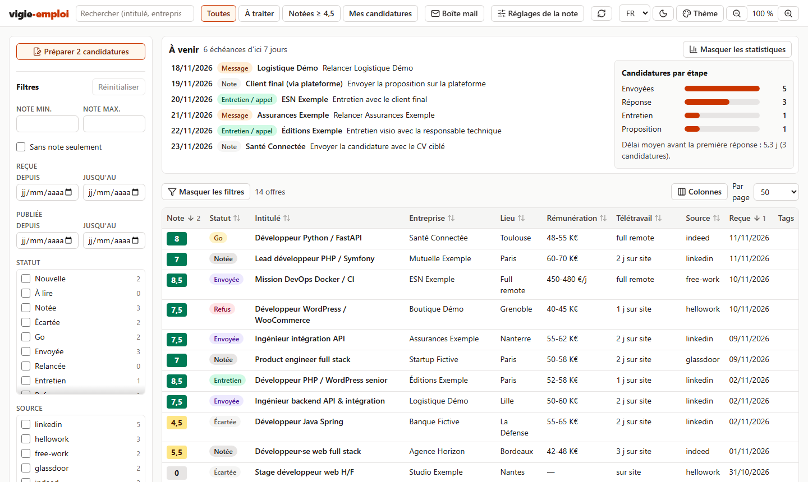
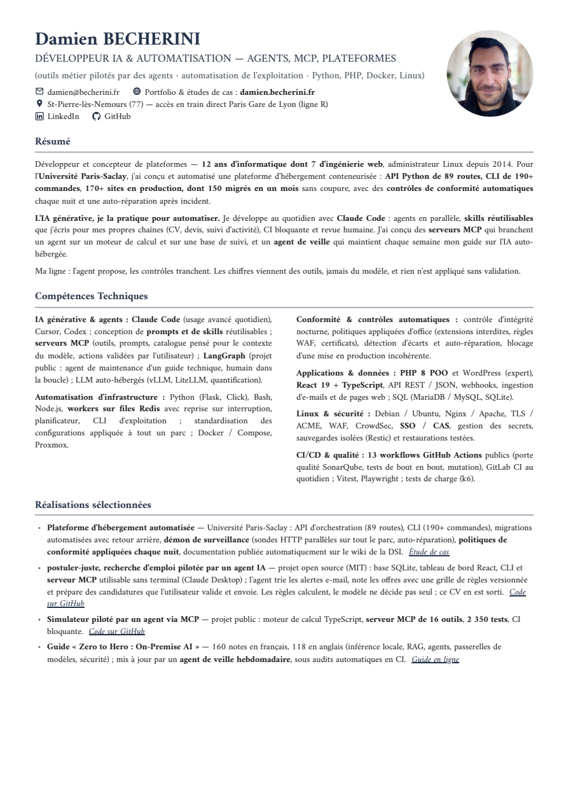
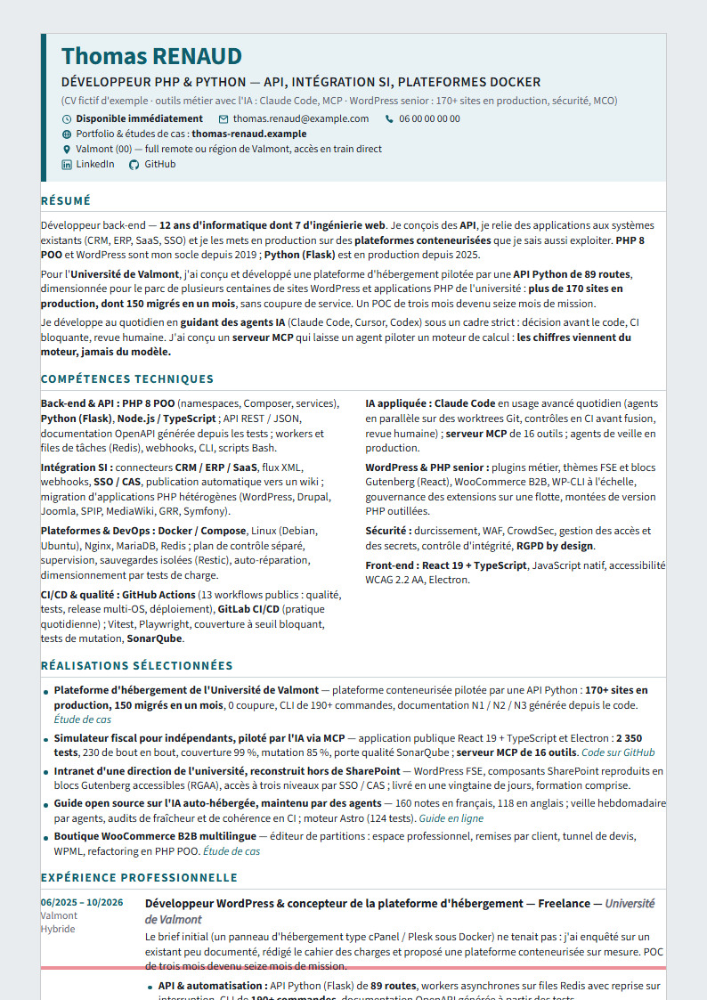

<div align="center">

# postuler-juste

**Français** · [English](README.en.md)

**Votre recherche d'emploi ou de missions, pilotée par votre IA, sans jamais vous faire mentir.**

[](LICENSE)
[](https://nodejs.org)
[](https://www.typescriptlang.org)
[](https://nodejs.org/api/sqlite.html)
[](https://modelcontextprotocol.io)
[](#ce-quil-faut)
[](#confidentialité)

</div>

---

postuler-juste est un kit local pour chercher un CDI ou des missions freelance avec un agent IA (Claude Code, Cursor, Codex…). L'IA trie les offres reçues par alertes e-mail, note chacune avec **votre** grille, prépare les candidatures que vous validez (dossier, CV ciblé, message) et tient le suivi. Tout reste sur votre ordinateur.

Postuler *juste*, dans les deux sens :

- **juste comme ciblé** : une grille de notation transparente et réglable (poids, plancher de rémunération, télétravail, règles bloquantes) ne vous présente que les offres qui valent le coup ;
- **juste comme honnête** : l'IA s'appuie sur un inventaire de ce que vous pouvez revendiquer ou non, construit avec vous au démarrage. Elle n'écrit dans un CV que ce que vous pouvez défendre en entretien. Au fil des candidatures, vous affinez avec elle ce qui fait votre valeur et le message que vous voulez faire passer, jusqu'à ce que le résultat vous ressemble vraiment.

## Comment ça marche

```
alertes e-mail (.eml)  →  tri et notation par l'IA (votre grille)  →  vos « go »
        →  dossier + CV ciblé (PDF, 2 pages) + message  →  envoi par vous  →  suivi (journal, échéances, relances)
```

1. **Démarrage guidé** : vous déposez votre CV (et l'export PDF de votre profil LinkedIn) dans `a-deposer/`. L'IA les lit, consulte vos pages publiques si elle le peut, puis vous interroge par petits groupes de questions : cibles, parcours, preuves, ce qui vous distingue, risques, interdits, conditions. Elle en tire votre **contexte** (`_CONTEXTE.md`), votre **grille** et un premier **CV**, que vous validez.
2. **Tri des alertes** : un filtre de votre messagerie enregistre les alertes (LinkedIn, Indeed, Glassdoor, Hellowork, Free-Work…) dans `emails/` (voir [Automatiser la réception des alertes](#automatiser-la-réception-des-alertes)). L'IA les ingère, écarte le hors-cible, note le reste critère par critère (l'application calcule la note) et vous présente les meilleures offres.
3. **Candidatures** : sur votre « go », l'IA prépare le dossier, un CV ciblé qui tient en deux pages et le message adapté au formulaire et à sa limite de caractères. **C'est vous qui envoyez.**
4. **Suivi** : vous racontez (« envoyé hier », « entretien jeudi à 14 h ») ; l'IA tient le journal, les échéances et le tableau de suivi.

L'application **n'appelle aucun modèle d'IA** : c'est votre agent qui lit et rédige, l'application garde l'état (base SQLite, tableau de bord web, CLI, serveur MCP).



*Le tableau de bord (données fictives) : offres triées par date de réception puis par note, échéances des sept prochains jours, candidatures par étape.*


*Le détail d'une offre : chaque critère, sa sous-note, son poids et son apport à la note finale, avec la justification de l'IA.*

### Les CV

Les CV s'écrivent en Markdown et sortent en PDF A4 de deux pages, avec trois gabarits fournis : « sobre » (à empattements), « moderne » (bandeau de couleur) et « compact » (une colonne, dense). L'IA peut aussi adapter la feuille de style à un modèle que vous lui montrez.

<div align="center">
<a href="docs/exemples/CV-exemple-sobre.pdf"></a>
<a href="docs/exemples/CV-exemple-moderne.pdf"></a>
<a href="docs/exemples/CV-exemple-compact.pdf"></a>

<em>Première page de chaque PDF (cliquez pour ouvrir le CV complet) : « sobre », « moderne », « compact ».</em>
</div>

## Ce qu'il faut

- **Node.js 24** ou plus.
- **Chrome, Edge ou Chromium** (pour les CV en PDF).
- **Un agent IA** qui travaille dans un dossier : Claude Code de préférence (serveur MCP et skills fournis) ; Cursor, Codex ou un autre agent lisent les mêmes consignes (`AGENTS.md`) et utilisent la CLI.
- Facultatif : un **navigateur piloté par l'IA** avec vos sessions (par exemple Claude in Chrome), pour lire les offres LinkedIn, Indeed ou Glassdoor. Sans lui, vous collez le texte des offres quand l'IA le demande.

## Démarrer

```sh
npx postuler-juste init ~/ma-recherche
```

Rien à cloner ni à compiler : npx télécharge l'application et lance `init`. L'espace de travail retient la version utilisée (`npx -y postuler-juste@<version>`, dans `.mcp.json` et dans les consignes de l'IA). Pour une commande installée à demeure : `npm install -g postuler-juste`, puis `postuler-juste init ~/ma-recherche`. Pour contribuer, installez depuis le dépôt (voir [Installation](#installation)).

`init` crée votre espace de travail (`--gabarit moderne` ou `compact` pour changer de gabarit de CV, `--langue en` pour un tableau de bord et une CLI en anglais) et affiche le prompt de démarrage à donner à votre IA. Ensuite :

1. glissez votre CV dans `~/ma-recherche/a-deposer/` ;
2. ouvrez votre IA dans `~/ma-recherche` (Claude Code : `cd ~/ma-recherche` puis `claude`, et acceptez le serveur MCP) ;
3. collez le prompt affiché par `init`.

Le démarrage se fait en deux sessions d'environ une demi-heure chacune.

## Automatiser la réception des alertes

L'IA traite les alertes qui se trouvent dans le dossier `emails/` de l'espace de travail, au format `.eml`. Vous pouvez y glisser les e-mails à la main depuis votre messagerie, mais le plus simple est un filtre qui le fait à chaque relève.

1. Créez des **alertes** sur les sites d'emploi que vous utilisez (LinkedIn, Indeed, Glassdoor, Hellowork, Free-Work…), avec vos mots-clés.
2. Configurez votre messagerie pour **enregistrer chaque alerte reçue en fichier `.eml` dans `emails/`**, puis la ranger dans un dossier à part.
3. Demandez ensuite à votre IA de « traiter les e-mails » (ou cliquez sur « Traiter les e-mails » dans le tableau de bord, avec Claude Code). Les fichiers traités sont supprimés de `emails/`.

### Exemple avec Thunderbird et FiltaQuilla

Thunderbird ne sait pas enregistrer un message en fichier depuis un filtre ; l'extension [FiltaQuilla](https://addons.thunderbird.net/thunderbird/addon/filtaquilla/) ajoute cette action.

**1. Installer et configurer FiltaQuilla**

- Menu **Outils → Modules complémentaires et thèmes**, recherchez « FiltaQuilla » et installez l'extension.
- Ouvrez ses **options** (Modules complémentaires → FiltaQuilla → Options). Dans la liste des actions, **activez « Save Message as File »** (enregistrer le message comme fichier) : elle est désactivée par défaut et n'apparaît pas dans les filtres tant qu'elle ne l'est pas.

**2. Créer le filtre**

- Menu **Outils → Filtres de messages**, choisissez le compte qui reçoit les alertes, puis **Nouveau**.
- Nommez-le, par exemple « Alertes offres ».
- Choisissez **« Remplir une des conditions suivantes »** et ajoutez une condition **Expéditeur → contient → l'adresse d'envoi des alertes** de chaque site (ouvrez une alerte reçue pour la relever).
- Dans **« Exécuter ces actions »** :
  1. **Save Message as File** : choisissez le dossier `emails/` de votre espace de travail (par exemple `~/ma-recherche/emails`) ;
  2. *(facultatif)* **Déplacer le message vers** un sous-dossier, par exemple « Alertes traitées » : vous voyez ainsi dans Thunderbird ce qui a déjà été transmis.
- Laissez le filtre s'appliquer à la **relève du courrier**. Pour les alertes déjà reçues : sélectionnez le filtre, puis **Exécuter maintenant** sur le dossier de réception.

Avec une autre messagerie, l'idée est la même : toute règle ou tout script capable d'enregistrer un message au format `.eml` dans `emails/` convient.

## Confidentialité

Votre espace de travail (CV, contexte, base, candidatures) reste sur votre disque. Rien n'est envoyé ailleurs que vers l'IA que vous utilisez. L'application ne télécharge que les pages publiques des offres Hellowork et Free-Work ; elle ne lit jamais LinkedIn, Indeed ni Glassdoor par script.

## Référence

Le reste de ce document décrit l'application en détail : commandes, configuration, grille, tableau de bord.

### Installation

Prérequis : Node.js 24 ou plus (SQLite est intégré à Node via `node:sqlite`, rien à compiler).

Depuis npm (le paquet contient le code compilé en JavaScript et l'interface compilée) :

```sh
npx postuler-juste init ~/ma-recherche    # sans installation
npm install -g postuler-juste             # ou commande installée à demeure
```

Commande inscrite par `init` dans `.mcp.json` et dans les consignes de l'espace :

- lancé par `npx` : `npx -y postuler-juste@<version>` (sous Windows, `cmd /c npx …` pour le serveur MCP). Le cache de npx peut être vidé : son chemin n'est jamais écrit. La version est figée pour que la base et l'application restent accordées ; au besoin, npx la retélécharge (connexion nécessaire). Les consignes de l'application (`AGENTS.md`) sont copiées dans `procedures/application.md`. Pour changer de version, remplacez le numéro dans `.mcp.json` et dans les consignes, ou passez à une installation globale ;
- installé (`npm install -g`, ou depuis le dépôt) : `node <chemin>/bin/postuler-juste.js`, avec le chemin absolu de l'installation.

Depuis le dépôt (contributeurs) :

```sh
git clone https://github.com/DamienBecherini/postuler-juste.git
cd postuler-juste
npm install
npm run build      # vérifie les types, compile src/ dans dist/ et l'interface dans dist/ui
npm link           # rend la commande `postuler-juste` disponible partout (facultatif)
```

Sans `npm link`, remplacez `postuler-juste` par `node <chemin>/bin/postuler-juste.js`. Dans le dépôt, `bin/postuler-juste.js` exécute directement le TypeScript de `src/` ; sans `src/` (paquet npm), il charge le JavaScript compilé de `dist/`, car Node refuse d'exécuter du TypeScript situé sous `node_modules`. `npm pack` et `npm publish` recompilent tout (`prepack`).

Anciens noms : l'application s'appelait **cap-emploi**. La commande `cap-emploi`, les variables `CAP_EMPLOI_*`, le fichier `cap-emploi.config.json` et la base `data/cap-emploi.sqlite` restent reconnus ; les nouveaux noms passent en premier.

### Créer son espace de travail

```sh
postuler-juste init <dossier> [--port 4410] [--nom-mcp postuler-juste] [--langue fr|en]
```

Le dossier doit être neuf ou vide. `init` y copie le modèle d'espace (`modele/` : consignes de l'IA, contexte à remplir, démarrage guidé, dossier `a-deposer/`, modèle de dossier de candidature), le gabarit de CV (`gabarits/cv/sobre/`) et la grille d'exemple, puis écrit `postuler-juste.config.json` et `.mcp.json` (serveur MCP lancé avec ce dossier de données). Il vérifie qu'un Chrome, Edge ou Chromium est disponible pour les PDF, et affiche le prompt de démarrage à donner à l'IA.

Pour essayer sans toucher à une installation existante : un autre dossier, un autre port et un autre nom de serveur MCP (`--port 4411 --nom-mcp postuler-juste-test`).

### Avec Claude Desktop ou un autre client MCP

Le serveur MCP (`postuler-juste mcp`) suffit à une IA qui n'a ni accès à vos fichiers ni terminal, comme Claude Desktop : il crée l'espace de travail (`initialiser_espace`, sans passer par `init`), fournit les consignes en prompts (`demarrage`, `traiter-emails`, `preparer-go`, `cv-cible`), lit vos documents déposés (texte, PDF, Word, images), écrit le contexte, les dossiers et les CV dans l'espace, et génère les PDF en montrant le rendu à l'IA. Déclarez le serveur dans `claude_desktop_config.json` avec le dossier de votre espace dans `POSTULER_JUSTE_DATA` (par défaut `~/ma-recherche`), redémarrez Claude Desktop, puis choisissez le prompt `demarrage`. Configuration et détails : [docs/utiliser-avec-une-ia.md](docs/utiliser-avec-une-ia.md#claude-desktop).

### CV en PDF

```sh
postuler-juste cv "cv/<nom>.md" [--gabarit <dossier>]
```

Convertit un CV Markdown en PDF A4 (Chrome, Edge ou Chromium sans interface ; `POSTULER_JUSTE_NAVIGATEUR` pour imposer un chemin), écrit à côté du `.md`, et affiche le nombre de pages (cible : 2). Le gabarit est un dossier (`gabarit.css`, polices, `portrait.jpg|png|webp` facultatif) : `--gabarit`, sinon `cv/gabarit/` de l'espace de travail, sinon celui de l'application. La structure Markdown attendue est décrite dans `modele/cv/LISEZMOI.md`.

### Configuration du dossier de données

Le dossier de données contient la base et la boîte de réception :

```
<dossier>/
  data/postuler-juste.sqlite   base (créée au premier lancement)
  emails/                  .eml à ingérer (supprimés une fois traités)
  candidatures/            historique facultatif à reprendre (voir import-historique)
  profil/grille.json       grille de notation (postuler-juste grille --init copie l'exemple)
```

Pour le désigner, au choix (du plus prioritaire au moins prioritaire) :

1. l'option `--data <dossier>` sur chaque commande ;
2. la variable d'environnement `POSTULER_JUSTE_DATA` ;
3. un fichier `postuler-juste.config.json` (non versionné) dans le dossier courant, dans le dossier de données ou à la racine de l'application. Modèle : [`postuler-juste.config.example.json`](postuler-juste.config.example.json).

| Clé | Rôle | Défaut |
|---|---|---|
| `dossierDonnees` | Dossier de données (chemin absolu ou relatif au fichier) | — |
| `base` | Chemin de la base | `<données>/data/postuler-juste.sqlite` |
| `emails` | Boîte de réception | `<données>/emails` |
| `port` | Port du tableau de bord | `4410` |
| `telechargerJsonLd` | Lire les pages Hellowork / Free-Work | `true` |
| `titresExclus` | Expressions régulières (sans casse) : intitulés écartés sans lecture | `[]` |
| `employeursRefuses` | Expressions régulières : employeurs refusés (intitulé, entreprise, début de la description) | `[]` |
| `terminal` | Commande qui ouvre un terminal avec l'agent (boutons du tableau de bord) ; `{dossier}` et `{invite}` y sont remplacés | Windows : `["wt.exe", "-d", "{dossier}", "claude", "{invite}"]` ; ailleurs : aucune |
| `langue` | Langue du tableau de bord, des messages de la CLI et du suivi généré : `fr` ou `en` (écrite par `init --langue`) ; le sélecteur de l'en-tête du tableau de bord l'emporte, pour ce navigateur | `fr` |

Variables d'environnement reconnues aussi : `POSTULER_JUSTE_CONFIG` (fichier de config), `POSTULER_JUSTE_BASE` (base), `POSTULER_JUSTE_PORT`, `POSTULER_JUSTE_LANGUE`.

### Commandes

Toutes les commandes acceptent `--json` (sortie stable pour une IA), `--data` et `--config`. `postuler-juste --help` donne la liste complète.

| Commande | Effet |
|---|---|
| `postuler-juste ingest [--keep] [--no-fetch] [--emails <dossier>]` | Lit les `.eml`, ajoute les nouvelles offres (`nouvelle`, ou `ecartee` avec le motif pour les intitulés exclus), puis **supprime les e-mails traités** (sauf `--keep`). Résumé : nouvelles, doublons, écartées, à lire |
| `postuler-juste import-historique` | Reprend `candidatures/_lots/*.json`, `candidatures/_ecartees.md`, `candidatures/_SUIVI.md` et les sections « Suivi » des `candidatures/*/dossier-candidature.md` (journal, voir plus bas) ; lecture seule, idempotent, avec un rapport des lignes non reconnues. Un `_SUIVI.md` généré par postuler-juste n'est pas relu |
| `postuler-juste list [filtres]` | Liste paginée : `--statut a,b`, `--note-min`, `--note-max`, `--sans-note`, `--source`, `--tag`, `--depuis` / `--jusqua` (réception), `--texte`, `--contrat`, `--teletravail`, `--candidatures`, `--page`, `--taille`, `--tri`, `--ordre` ; tri sur plusieurs niveaux : `--tri recue_le:desc,note:desc` |
| `postuler-juste show <id>` | Détail : description, notes, historique des statuts, tags, candidature |
| `postuler-juste a-lire [--limite N] [--complet]` | Offres à traiter sans note, avec l'URL à lire, ou la description déjà extraite |
| `postuler-juste noter <id> --json '{…}'` | Enregistre une note pour une offre |
| `postuler-juste noter --fichier lot.json [--essai]` | Enregistre un lot de notes (offres retrouvées par `id` ou par `url`, créées au besoin) ; `--essai` calcule sans enregistrer |
| `postuler-juste grille [--consignes]` | Grille de notation courante : critères et poids, barèmes, règles, inventaire, exemples (`--consignes` : consignes pour l'IA) |
| `postuler-juste grille --modifier '{…}' --resume "…" [--essai]` | Changement partiel (poids, seuil, barèmes, règles, inventaire) ; nouvelle version et renotation, ou aperçu avec `--essai` |
| `postuler-juste grille --historique` / `--version N` / `--restaurer N` / `--init` | Versions de la grille, retour à une version, copie de la grille d'exemple |
| `postuler-juste renoter` | Recalcule les notes à critères avec la grille courante |
| `postuler-juste statut <id> <statut> [--commentaire "…"]` | Change le statut (historisé) |
| `postuler-juste tag <id> +ajout -retrait` | Ajoute / retire des tags |
| `postuler-juste candidater <id>` | Passe l'offre en `go` et affiche ce qu'il faut pour préparer la candidature |
| `postuler-juste candidature <id> [--dossier] [--cv] [--canal] [--envoyee-le] [--message] [--prochaine-action]` | Enregistre la candidature (`""` efface un champ) ; avec `--envoyee-le`, l'offre passe en `envoyee` |
| `postuler-juste prochaine-action <id> "texte"` | Prochaine action de la candidature (`-` pour l'effacer) |
| `postuler-juste lien <id> <url ou ->` | Lien de l'offre |
| `postuler-juste evenement <id> --type <type> [--le "JJ/MM/AAAA HH:MM"] --resume "…" [--sens envoye\|recu] [--canal] [--interlocuteurs] [--details] [--montant 3000 --unite "€ HT"] [--jours 6] [--fichier <chemin>]… [--fait\|--no-fait]` | Ajoute un événement au journal (types : `message`, `entretien`, `test`, `proposition`, `decision`, `note`). `--le` : JJ/MM/AAAA, AAAA-MM-JJ, avec heure facultative, `demain`, `+3` ; par défaut maintenant. Daté dans le futur, il n'est pas fait : c'est une échéance |
| `postuler-juste journal <id>` | Journal de la candidature : échéances d'abord (retards en tête), puis du plus récent au plus ancien |
| `postuler-juste echeances [--jours 7]` | Échéances en retard et à venir sur N jours, toutes offres confondues |
| `postuler-juste fait <evenement_id> [--no-fait]` | Marque une échéance comme faite (ou la rouvre) |
| `postuler-juste fichiers <id>` | Fichiers du dossier de candidature (chemins à citer dans `--fichier`) |
| `postuler-juste stats` | Candidatures par étape (envoyée, réponse, entretien, proposition) et délai moyen avant la première réponse |
| `postuler-juste generer-suivi [--sortie <fichier>] [--remplacer]` | Génère le suivi des candidatures depuis la base : `candidatures/_SUIVI.genere.md` par défaut (aperçu), `candidatures/_SUIVI.md` avec `--remplacer` |
| `postuler-juste mcp` | Serveur MCP (stdio) pour une IA |
| `postuler-juste serve [--port 4410] [--inactivite <minutes>]` | Lance le tableau de bord sur http://localhost:4410 ; avec `--inactivite`, il s'arrête seul après ce temps sans visite (`GET /api/sante` donne le temps restant) |

Statuts : `nouvelle`, `a-lire`, `notee`, `ecartee`, `go`, `envoyee`, `relancee`, `entretien`, `refus`, `close`, `abandonnee`. « Mes candidatures » regroupe `envoyee` et les suivants.

Format d'une note (celui des lots) :

```json
{
  "source": "linkedin", "url": "https://www.linkedin.com/jobs/view/1234567890/",
  "titre": "…", "entreprise": "…", "lieu": "…", "contrat": "CDI", "remuneration": "50-60 K€",
  "teletravail": "hybride", "publiee": "NC", "stack": "PHP, API",
  "criteres": {
    "technique": { "note": 8, "justification": "PHP, API REST ; écart : PostgreSQL" },
    "role": { "note": 7, "justification": "…" },
    "interet": { "note": 6, "justification": "…" },
    "risque": { "note": 7, "justification": "…" }
  },
  "entrees": { "jours_sur_site": 2, "salaire_min": 55000, "salaire_max": 65000, "unite": "an" },
  "bloquants": [],
  "colle": "…", "ecarts": "…", "lu": true
}
```

Avec `criteres` (ou `entrees`, `bloquants`), la note est **calculée** avec la grille ; un champ `note` fourni est ignoré et signalé dans `avertissements`. La réponse contient la note, la valeur exacte et la décomposition. Sans `criteres`, c'est une note globale de l'ancienne grille (`note`, `note_brute`, `penalites`), qui reste figée. Champs facultatifs : `id` (à la place de `url`), `description`, `tags`. Les champs descriptifs ne complètent que ce qui manque ; la dernière note fait foi.

### Grille de notation

La grille vit dans `<données>/profil/grille.json` (modèle générique : [`exemples/grille.json`](exemples/grille.json), copié par `postuler-juste grille --init`). Elle contient :

- **critères pondérés** (7 au plus) notés de 0 à 10 : par l'IA (`source: "ia"`, avec une consigne dans `description`) ou par l'application (`source: "calcul"`, `calcul: "teletravail"` ou `"remuneration"`) ; poids relatifs, normalisés à 100 % ;
- **barèmes** : télétravail (sous-note pour 0 à 5 jours sur site, valeur « inconnu ») ; rémunération (salaire en K€/an et TJM en €/j : plancher = 5, cible haute = 10, sous le plancher = 0, linéaire entre ; plancher full remote facultatif ; milieu, bas ou haut de fourchette) ;
- **règles bloquantes** : identifiant, libellé, effet `zero` ou `plafond` + valeur, active ou non ;
- **inventaire de compétences** (technologie → fort / moyen / léger / zéro), lu par l'IA pour le critère technique ;
- **seuil « à regarder »** (vue rapide « Notées ≥ … ») ;
- **exemples de référence** (offres notées critère par critère, avec justification) pour caler l'IA ;
- **consignes** générales pour l'IA.

Calcul : moyenne pondérée des sous-notes → règles bloquantes (zéro, plafond) → arrondi au demi-point pour l'affichage et les filtres (la valeur exacte est gardée). Donnée manquante (critère non noté, télétravail ou salaire inconnus) : valeur neutre 5 et un **drapeau** sur l'offre. Les jours sur site et le salaire viennent de `entrees`, sinon des champs télétravail et rémunération de l'offre.

Chaque enregistrement (panneau, CLI, MCP, ou fichier modifié à la main) crée une **version** (numéro, date, auteur, résumé) et **recalcule toutes les notes à critères**, sans relire d'offre. Les anciennes notes globales restent telles quelles (badge « ancienne grille »). On peut revenir à une version précédente (elle devient une nouvelle version).

### Tableau de bord

`postuler-juste serve`, puis http://localhost:4410 (écoute sur 127.0.0.1 uniquement).

- Tableau paginé côté serveur (25 à 500 lignes par page), tri par colonne à la Thunderbird (le dernier en-tête cliqué devient le tri principal, le précédent passe en secondaire : cliquer Note puis Reçue le trie par date, puis par note à date égale ; l'adresse garde les niveaux), colonnes masquables.
- Filtres : note, dates de réception et de publication, source, statut, contrat, télétravail, tags, recherche plein texte (accents ignorés). Les filtres sont dans l'URL : on peut la garder en favori.
- Vues rapides : à traiter, notées ≥ seuil de la grille (4,5 par défaut), mes candidatures.
- **Réglages de la note** (bouton de l'en-tête) : curseurs des poids (total normalisé affiché), seuil, barèmes télétravail et rémunération, règles bloquantes (activer, effet, plafond, ajout, suppression), inventaire (ajout, modification, suppression, filtre), exemples de référence recalculés en direct ; **aperçu avant d'enregistrer** (offres dont la note change, offres qui franchissent le seuil, cliquables) ; résumé du changement obligatoire ; historique des versions et restauration.
- **Travail pour l'agent**, au-dessus des filtres, seulement s'il y en a : « Traiter N e-mails » (des `.eml` attendent dans la boîte de réception) et « Préparer N candidatures » (offres en `go` sans dossier). Chaque bouton ouvre un terminal dans le dossier de données avec l'agent et la commande `/traiter-emails` ou `/preparer-go` (à fournir par le dossier de données, par exemple sous forme de skills Claude Code) ; la suite se passe dans ce terminal. Voir [ADR 0005](docs/adr/0005-boutons-agent-et-notifications.md).
- **Mise à jour en direct** : le serveur prévient la page (Server-Sent Events, `/api/flux`) quand la base change, quelle que soit l'origine de l'écriture (CLI, agent, autre onglet), et quand la boîte de réception change ; la page recharge alors ses données. Le bouton « Rafraîchir » reste disponible.
- Bandeau **À venir** au-dessus du tableau : échéances en retard et des 7 prochains jours, chacune ouvre son offre ; bouton **Statistiques** (candidatures par étape, délai de réponse).
- Panneau de détail : description, lien vers l'offre (modifiable), **décomposition de la note** (critère par critère : sous-note, poids, apport, justification, origine ; règles appliquées ; drapeaux ; valeur exacte et version de la grille), badge « ancienne grille » pour une note globale, **correction des sous-notes** (critères IA, jours sur site, salaire, règles ; la note est recalculée et s'ajoute à l'historique), note globale à l'ancienne, **candidature** (prochaine action, date d'envoi, canal), **journal** (échéances en tête, retards en rouge ; ajouter, modifier, supprimer un événement, marquer une échéance faite ; lier un fichier du dossier choisi dans une liste), **fichiers du dossier** (liens qui les ouvrent), historique des statuts, tags éditables, changement de statut, bouton **Candidater** (copie `candidater <id>` dans le presse-papiers et passe l'offre en `go`).
- Fichiers : servis en lecture par `/api/fichier/<chemin>`, uniquement dans le dossier de données (pas de `..`, pas de fichiers cachés, ni `data/` ni `emails/`, liens symboliques résolus) ; Markdown rendu en HTML simple sans script (CSP), `?brut=1` pour le texte, PDF et images tels quels. Le serveur refuse les requêtes dont l'hôte n'est pas `localhost` / `127.0.0.1`, et les écritures venues d'une autre origine (en-tête `Origin` non local ou `Sec-Fetch-Site: cross-site`).
- Thème clair / sombre / système, taille du texte réglable (mémorisés dans le navigateur), navigation au clavier (Entrée ouvre une offre, Échap ferme le panneau).

Développement de l'interface : `postuler-juste serve` d'un côté, `npm run dev:ui` de l'autre (Vite sur http://localhost:5173, l'API est relayée vers le port 4410 ; `POSTULER_JUSTE_API` pour en changer).

### Suivi des candidatures généré

`postuler-juste generer-suivi` écrit le suivi au format de l'ancien `_SUIVI.md` : sections **En cours** (à envoyer d'abord, puis du dernier envoi au plus ancien), **Envoyées sans suite** (statut « sans nouvelles » ou « sans réponse »), **Closes** (refus, abandon, clôture), colonnes Offre, Type, Canal, Envoyé, Statut, Prochaine action, Dossier, liens vers les dossiers. En tête : « Fichier généré par postuler-juste le … : ne pas éditer à la main ».

Colonne Prochaine action : la prochaine échéance du journal (« **04/11** : Relancer », « (en retard) » si la date est passée), sinon le champ `prochaine_action`.

Tant qu'une candidature n'a pas bougé depuis la reprise, ses cellules sont réécrites telles quelles ; ensuite la colonne Statut reprend le commentaire du dernier statut. La prochaine action saisie dans l'interface, la CLI ou par MCP n'est jamais écrasée par une nouvelle reprise de l'ancien `_SUIVI.md`.

Bascule : comparer `_SUIVI.genere.md` à `_SUIVI.md`, puis `postuler-juste generer-suivi --remplacer`. Après la bascule, la base fait foi.

### Journal et échéances

**La base sait ce qui s'est passé et quand ; le dossier Markdown garde les documents.** Un événement a un type, une date (ou date-heure), un résumé, et au besoin : sens (envoyé / reçu), canal, interlocuteurs, montant + unité, jours, détails, fichiers (chemins relatifs au dossier de données). Une date future non faite est une échéance ; passée et non faite, elle est en retard.

Reprise (`import-historique`) : les sections « Suivi » des dossiers actifs (`candidatures/*/dossier-candidature.md`, pas `_archives/`) deviennent des événements d'origine `import` : lignes des tableaux Date | Événement, puces datées « - 13/10/2026 — … », cases cochées datées « - [x] Envoyée le : 13/10/2026 ». Les cases non cochées (à faire) ne sont pas reprises. Type deviné (message, entretien, test, proposition, décision ; `note` à défaut, listées dans le rapport), liens Markdown relatifs et chemins entre accents graves vers des fichiers existants. Idempotent : une empreinte par ligne ; une ligne disparue du dossier retire l'événement repris s'il n'a pas été modifié depuis. Un dossier qu'aucune candidature ne désigne est rattaché à la candidature sans dossier dont l'entreprise figure dans son nom (si elle est unique).

Une offre déjà suivie (`go` et au-delà) revue dans une alerte e-mail, un lot noté ou le registre ne change plus de statut ; l'alerte laisse une trace au journal (« Revue le … », une par jour).

### Développement

```sh
npm test            # Vitest (fixtures fictives dans tests/fixtures)
npm run typecheck   # TypeScript (serveur + interface)
npm run build       # typecheck + compilation de l'interface
```

Arborescence :

```
bin/postuler-juste.js   point d'entrée de la commande (TypeScript de src/ dans le dépôt, JavaScript de dist/ dans le paquet npm)
migrations/         schéma SQL versionné (PRAGMA user_version)
src/core/           configuration, liens, normalisation, opérations sur les offres, requêtes,
                    grille de notation (grille.ts : schéma et calcul purs ; grille-stockage.ts : fichier, versions, renotation)
exemples/           grille de notation d'exemple (générique)
src/db/             ouverture de la base et migrations
src/ingest/         lecture des .eml, JSON-LD, ingestion
src/import/         reprise de l'historique Markdown / JSON (dont les journaux des dossiers)
src/cli/            commandes
src/api/            serveur HTTP (Hono) : API JSON, lecture des fichiers du dossier, interface compilée
src/mcp/            serveur MCP (stdio), outils branchés sur src/core
src/export/         génération du suivi des candidatures (Markdown)
ui/                 interface React 19 + Vite + Tailwind CSS v4 + TanStack Table / Query
docs/adr/           décisions d'architecture
```

Voir aussi [`AGENTS.md`](AGENTS.md) (pilotage par une IA), [`docs/utiliser-avec-une-ia.md`](docs/utiliser-avec-une-ia.md) (brancher le serveur MCP), [`docs/adr/0001-choix-techniques.md`](docs/adr/0001-choix-techniques.md), [`docs/adr/0002-mcp-et-suivi.md`](docs/adr/0002-mcp-et-suivi.md) [`docs/adr/0003-journal-et-echeances.md`](docs/adr/0003-journal-et-echeances.md) et [`docs/adr/0004-grille-de-notation.md`](docs/adr/0004-grille-de-notation.md).

## Licence

Code sous licence MIT (voir `LICENSE`). Polices des gabarits de CV sous licence SIL Open Font License : Amiri (gabarit « sobre ») et Source Sans 3 (gabarits « moderne » et « compact ») ; texte de la licence dans le dossier `fonts/` de chaque gabarit.
