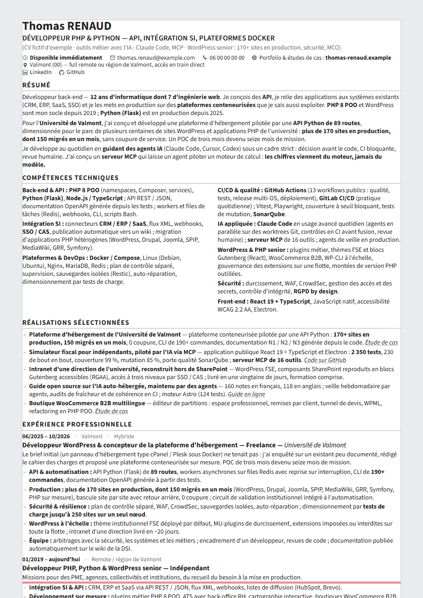

<div align="center">

# vigie-emploi

**Français** · [English](README.en.md)

**Votre recherche d'emploi ou de missions, pilotée par votre IA, sans jamais vous faire mentir.**

[](LICENSE)
[](https://nodejs.org)
[](https://www.typescriptlang.org)
[](https://nodejs.org/api/sqlite.html)
[](https://modelcontextprotocol.io)
[](#ce-quil-faut)
[](#confidentialité)

</div>

---

vigie-emploi est un kit local pour chercher un CDI ou des missions freelance avec un agent IA (Claude Code, Cursor, Codex…). L'IA trie les offres reçues par alertes e-mail, note chacune avec **votre** grille, prépare les candidatures que vous validez (dossier, CV ciblé, message) et tient le suivi. Tout reste sur votre ordinateur.

Une vigie, c'est le guetteur en haut du mât : il repère ce qui compte et le signale. Deux promesses :

- **elle trie pour vous** : les alertes que votre messagerie dépose sont lues d'un seul passage quand vous lancez le tri, une grille de notation transparente et réglable (poids, plancher de rémunération, télétravail, règles bloquantes) ne vous présente que les offres qui valent le coup, et chaque relance a sa date ;
- **elle ne vous fait jamais mentir** : l'IA s'appuie sur un inventaire de ce que vous pouvez revendiquer ou non, construit avec vous au démarrage. Elle n'écrit dans un CV que ce que vous pouvez défendre en entretien. Au fil des candidatures, vous affinez avec elle ce qui fait votre valeur et le message que vous voulez faire passer, jusqu'à ce que le résultat vous ressemble vraiment.

## Comment ça marche

```
alertes e-mail (.eml)  →  tri et notation par l'IA (votre grille)  →  vos « go »
        →  dossier + CV ciblé (PDF, 2 pages) + message  →  envoi par vous  →  suivi (journal, échéances, relances)
```

1. **Démarrage guidé** : vous déposez votre CV (et l'export PDF de votre profil LinkedIn) dans `a-deposer/`. L'IA les lit, consulte vos pages publiques si elle le peut, puis vous interroge par petits groupes de questions : cibles, parcours, preuves, ce qui vous distingue, risques, interdits, conditions. Elle en tire votre **contexte** (`_CONTEXTE.md`), votre **grille** et un premier **CV**, que vous validez.
2. **Tri des alertes** : un filtre de votre messagerie enregistre les alertes (LinkedIn, Indeed, Glassdoor, Hellowork, Free-Work…) dans `emails/` (voir [Automatiser la réception des alertes](#automatiser-la-réception-des-alertes)). L'IA les ingère, écarte le hors-cible, note le reste critère par critère (l'application calcule la note) et vous présente les meilleures offres.
3. **Candidatures** : sur votre « go », l'IA prépare le dossier, un CV ciblé qui tient en deux pages et le message adapté au formulaire et à sa limite de caractères. **C'est vous qui envoyez.**
4. **Suivi** : vous racontez (« envoyé hier », « entretien jeudi à 14 h ») ; l'IA tient le journal, les échéances et le tableau de suivi.

L'application **n'appelle aucun modèle d'IA** : c'est votre agent qui lit et rédige, l'application garde l'état (base SQLite, tableau de bord web, CLI, serveur MCP).


*Le tableau de bord (données fictives) : offres triées par date de réception puis par note, échéances des sept prochains jours, candidatures par étape.*


*Le détail d'une offre : chaque critère, sa sous-note, son poids et son apport à la note finale, avec la justification de l'IA.*

### Les CV

Les CV s'écrivent en Markdown et sortent en PDF A4 de deux pages, avec trois gabarits fournis : `plain` (sobre, à empattements), `modern` (bandeau de couleur) et `compact` (une colonne, dense). L'IA peut aussi adapter la feuille de style à un modèle que vous lui montrez.

<div align="center">
<a href="docs/exemples/CV-damien-becherini-plain.pdf"></a>
<a href="docs/exemples/CV-damien-becherini-modern.pdf"></a>
<a href="docs/exemples/CV-damien-becherini-compact.pdf"></a>

<em>Mon propre CV, écrit avec vigie-emploi et rendu avec chacun des trois gabarits (première page ; cliquez pour ouvrir le PDF complet). Source Markdown : <a href="docs/exemples/CV-damien-becherini.md">docs/exemples/CV-damien-becherini.md</a>.</em>
</div>

## Ce qu'il faut

- **Node.js 24** ou plus, sauf avec l'extension Claude Desktop (elle utilise le Node intégré à l'application).
- **Chrome, Edge ou Chromium** (pour les CV en PDF).
- **Une IA** : Claude Desktop (extension en un clic, rien d'autre à installer), ou un agent qui travaille dans un dossier : Claude Code de préférence (serveur MCP et skills fournis) ; Cursor, Codex ou un autre agent lisent les mêmes consignes (`AGENTS.md`) et utilisent la CLI.
- Facultatif : un **navigateur piloté par l'IA** avec vos sessions (par exemple Claude in Chrome), pour lire les offres LinkedIn, Indeed ou Glassdoor. Sans lui, vous collez le texte des offres quand l'IA le demande.

## Démarrer

### Installation en un clic (Claude Desktop)

1. Téléchargez le fichier `vigie-emploi-<version>.mcpb` (page [Releases](https://github.com/DamienBecherini/vigie-emploi/releases) du dépôt).
2. Double-cliquez dessus (ou glissez-le dans la fenêtre de Claude Desktop, ou **Paramètres → Extensions → Paramètres avancés → Installer une extension…**), puis cliquez sur **Installer**.
3. Choisissez le **dossier de l'espace** (par défaut `ma-recherche` dans votre dossier personnel ; il n'a pas besoin d'exister) et la **langue** (`fr` ou `en`).
4. Dans une nouvelle conversation, demandez « crée mon espace vigie-emploi », ou bouton **+** → vigie-emploi → prompt **`onboarding`**. Claude crée l'espace, vous demande de déposer votre CV dans `a-deposer/`, puis mène le démarrage.

Pas de terminal ni de Node à installer : l'extension contient l'application et utilise le Node intégré à Claude Desktop. Pour parcourir vos offres dans le tableau de bord, demandez à Claude de l'ouvrir (outil `open_dashboard`). Détails : [docs/utiliser-avec-une-ia.md](docs/utiliser-avec-une-ia.md#claude-desktop).

### Avec Claude Code ou un autre agent

```sh
npx vigie-emploi init ~/ma-recherche
```

Rien à cloner ni à compiler : npx télécharge l'application et lance `init`. L'espace de travail retient la version utilisée (`npx -y vigie-emploi@<version>`, dans `.mcp.json` et dans les consignes de l'IA). Pour une commande installée à demeure : `npm install -g vigie-emploi`, puis `vigie-emploi init ~/ma-recherche`. Pour contribuer, installez depuis le dépôt (voir [Installation](#installation)).

`init` crée votre espace de travail (`--template modern` ou `compact` pour changer de gabarit de CV, `--language en` pour tout en anglais : consignes de l'IA et modèle de l'espace, grille d'exemple, serveur MCP, tableau de bord et CLI ; les noms de commandes et de statuts sont les mêmes dans toutes les langues, ceux des fichiers de l'espace restent en français) et affiche le prompt de démarrage à donner à votre IA. Ensuite :

1. glissez votre CV dans `~/ma-recherche/a-deposer/` ;
2. ouvrez votre IA dans `~/ma-recherche` (Claude Code : `cd ~/ma-recherche` puis `claude`, et acceptez le serveur MCP) ;
3. collez le prompt affiché par `init`.

Le démarrage se fait en deux sessions d'environ une demi-heure chacune.

## Automatiser la réception des alertes

L'IA traite les alertes d'offres qui arrivent dans l'application. Le plus simple : **l'application relève elle-même un dossier de votre boîte mail** (IMAP), sur Windows, macOS ou Linux, sans logiciel de messagerie.

1. Créez des **alertes** sur les sites d'emploi que vous utilisez (LinkedIn, Indeed, Glassdoor, Hellowork, Free-Work…), avec vos mots-clés.
2. Dans votre messagerie, créez un **dossier** (un libellé dans Gmail), par exemple « Alertes emploi », et un **filtre** qui y range les alertes (condition : l'expéditeur de chaque site).
3. Connectez la boîte : bouton **« Boîte mail »** du tableau de bord, ou `vigie-emploi mail setup` dans un terminal. Adresse, mot de passe, choix du dossier.
4. Demandez ensuite à votre IA de « traiter les e-mails » : elle relève le dossier, puis trie et note les nouvelles offres.

L'application ne fait que lire : rien n'est supprimé ni déplacé dans la boîte, les messages relevés sont seulement marqués comme lus (`markSeen: false` pour l'éviter). Chaque message n'est relevé qu'une fois ; la première relève se limite aux 14 derniers jours.

| Messagerie | Mot de passe à saisir |
| --- | --- |
| Gmail, Yahoo, iCloud | un **mot de passe d'application** (validation en deux étapes requise ; Gmail : https://myaccount.google.com/apppasswords) |
| Orange, Free, SFR, La Poste, GMX | le mot de passe habituel |
| Outlook.com, Hotmail, Microsoft 365 | pas encore géré : faites suivre les alertes vers une autre boîte, ou utilisez une méthode ci-dessous |
| Autre | celui de la boîte, avec le serveur IMAP indiqué par votre fournisseur |

Le mot de passe est confié au système, jamais écrit dans l'espace de travail ni dans la configuration : chiffré pour votre session Windows (DPAPI, dans `%APPDATA%\vigie-emploi`), trousseau de macOS, trousseau du bureau sous Linux (Secret Service), ou à défaut un fichier lisible par vous seul dans `~/.config/vigie-emploi`. La variable `VIGIE_EMPLOI_MAIL_PASSWORD` le remplace si elle est définie. Les réglages (adresse, serveur, dossier) vont dans la section `mail` de `vigie-emploi.config.json`.

### Autres méthodes

L'IA traite aussi tout fichier `.eml` déposé dans le dossier `emails/` de l'espace de travail :

- **glisser-déposer** les alertes depuis votre messagerie, une fois par jour suffit ;
- **Thunderbird et l'extension [FiltaQuilla](https://addons.thunderbird.net/thunderbird/addon/filtaquilla/)** : activez l'action « Save Message as File » dans les options de FiltaQuilla, puis créez un filtre (Outils → Filtres de messages) qui, pour les expéditeurs des alertes, enregistre le message dans `emails/` à chaque relève du courrier ;
- tout autre règle ou script capable d'enregistrer un message au format `.eml` dans `emails/`.

## Confidentialité

Votre espace de travail (CV, contexte, base, candidatures) reste sur votre disque. Rien n'est envoyé ailleurs que vers l'IA que vous utilisez. L'application ne télécharge que les pages publiques des offres Hellowork et Free-Work ; elle ne lit jamais LinkedIn, Indeed ni Glassdoor par script. Si vous connectez votre boîte mail, elle ne lit que le dossier choisi, directement depuis votre ordinateur, et garde le mot de passe dans le trousseau du système.

## Référence

Le reste de ce document décrit l'application en détail : commandes, configuration, grille, tableau de bord.

### Installation

Prérequis : Node.js 24 ou plus (SQLite est intégré à Node via `node:sqlite`, rien à compiler).

Depuis npm (le paquet contient le code compilé en JavaScript et l'interface compilée) :

```sh
npx vigie-emploi init ~/ma-recherche    # sans installation
npm install -g vigie-emploi             # ou commande installée à demeure
```

Commande inscrite par `init` dans `.mcp.json` et dans les consignes de l'espace :

- lancé par `npx` : `npx -y vigie-emploi@<version>` (sous Windows, `cmd /c npx …` pour le serveur MCP). Le cache de npx peut être vidé : son chemin n'est jamais écrit. La version est figée pour que la base et l'application restent accordées ; au besoin, npx la retélécharge (connexion nécessaire). Les consignes de l'application (`AGENTS.md`, ou `AGENTS.en.md` pour un espace anglais) sont copiées dans `procedures/application.md`. Pour changer de version, remplacez le numéro dans `.mcp.json` et dans les consignes, ou passez à une installation globale ;
- installé (`npm install -g`, ou depuis le dépôt) : `node <chemin>/bin/vigie-emploi.js`, avec le chemin absolu de l'installation.

Depuis le dépôt (contributeurs) :

```sh
git clone https://github.com/DamienBecherini/vigie-emploi.git
cd vigie-emploi
npm install
npm run build      # vérifie les types, compile src/ dans dist/ et l'interface dans dist/ui
npm link           # rend la commande `vigie-emploi` disponible partout (facultatif)
```

Sans `npm link`, remplacez `vigie-emploi` par `node <chemin>/bin/vigie-emploi.js`. Dans le dépôt, `bin/vigie-emploi.js` exécute directement le TypeScript de `src/` ; sans `src/` (paquet npm), il charge le JavaScript compilé de `dist/`, car Node refuse d'exécuter du TypeScript situé sous `node_modules`. `npm pack` et `npm publish` recompilent tout (`prepack`).

### Créer son espace de travail

```sh
vigie-emploi init <dossier> [--port 4410] [--mcp-name vigie-emploi] [--language fr|en]
```

Le dossier doit être neuf ou vide. `init` y copie le modèle d'espace (`scaffold/` : consignes de l'IA, contexte à remplir, démarrage guidé, dossier `a-deposer/`, modèle de dossier de candidature), le gabarit de CV (`templates/cv/plain/`) et la grille d'exemple, puis écrit `vigie-emploi.config.json` et `.mcp.json` (serveur MCP lancé avec ce dossier de données). Il vérifie qu'un Chrome, Edge ou Chromium est disponible pour les PDF, et affiche le prompt de démarrage à donner à l'IA.

Pour essayer sans toucher à une installation existante : un autre dossier, un autre port et un autre nom de serveur MCP (`--port 4411 --mcp-name vigie-emploi-test`).

### Avec Claude Desktop ou un autre client MCP

Le serveur MCP (`vigie-emploi mcp`) suffit à une IA qui n'a ni accès à vos fichiers ni terminal, comme Claude Desktop : il crée l'espace de travail (`initialize_workspace`, sans passer par `init`), fournit les consignes en prompts (`onboarding`, `process-emails`, `prepare-go`, `targeted-cv`), lit vos documents déposés (texte, PDF, Word, images), écrit le contexte, les dossiers et les CV dans l'espace, et génère les PDF en montrant le rendu à l'IA ; il démarre aussi le tableau de bord (`open_dashboard`). Avec Claude Desktop, le plus simple est l'extension `.mcpb` ([Installation en un clic](#installation-en-un-clic-claude-desktop)) ; on peut aussi déclarer le serveur à la main dans `claude_desktop_config.json`, avec le dossier de votre espace dans `VIGIE_EMPLOI_DATA` (par défaut `~/ma-recherche`). Configuration et détails : [docs/utiliser-avec-une-ia.md](docs/utiliser-avec-une-ia.md#claude-desktop).

Construire l'extension (pour une release GitHub) : `npm run mcpb` compile l'application, prépare `build/mcpb/vigie-emploi/` (JavaScript compilé, interface, modèles, gabarits, `node_modules` de production seulement), valide `mcpb/manifest.json` et emballe le tout dans `build/vigie-emploi-<version>.mcpb` (environ 5 Mo) avec l'outil officiel `@anthropic-ai/mcpb`. Joindre ce fichier à la release.

### CV en PDF

```sh
vigie-emploi cv "cv/<nom>.md" [--template <dossier>]
```

Convertit un CV Markdown en PDF A4 (Chrome, Edge ou Chromium sans interface ; `VIGIE_EMPLOI_BROWSER` pour imposer un chemin), écrit à côté du `.md`, et affiche le nombre de pages (cible : 2). Le gabarit est un dossier (`gabarit.css`, polices, `portrait.jpg|png|webp` facultatif) : `--template`, sinon `cv/gabarit/` de l'espace de travail, sinon celui de l'application. La structure Markdown attendue est décrite dans `scaffold/cv/LISEZMOI.md`.

### Configuration du dossier de données

Le dossier de données contient la base et la boîte de réception :

```
<dossier>/
  data/vigie-emploi.sqlite   base (créée au premier lancement)
  emails/                  .eml à ingérer (supprimés une fois traités)
  candidatures/            historique facultatif à reprendre (voir import-history)
  profil/grille.json       grille de notation (vigie-emploi rubric --init copie l'exemple)
```

Pour le désigner, au choix (du plus prioritaire au moins prioritaire) :

1. l'option `--data <dossier>` sur chaque commande ;
2. la variable d'environnement `VIGIE_EMPLOI_DATA` ;
3. un fichier `vigie-emploi.config.json` (non versionné) dans le dossier courant, dans le dossier de données ou à la racine de l'application. Modèle : [`vigie-emploi.config.example.json`](vigie-emploi.config.example.json).

| Clé | Rôle | Défaut |
|---|---|---|
| `dataDir` | Dossier de données (chemin absolu ou relatif au fichier) | — |
| `database` | Chemin de la base | `<données>/data/vigie-emploi.sqlite` |
| `emails` | Boîte de réception | `<données>/emails` |
| `port` | Port du tableau de bord | `4410` |
| `fetchJsonLd` | Lire les pages Hellowork / Free-Work | `true` |
| `excludedTitles` | Expressions régulières (sans casse) : intitulés écartés sans lecture | `[]` |
| `rejectedEmployers` | Expressions régulières : employeurs refusés (intitulé, entreprise, début de la description) | `[]` |
| `terminal` | Commande qui ouvre un terminal avec l'agent (boutons du tableau de bord) ; `{folder}` et `{prompt}` y sont remplacés | Windows : `["wt.exe", "-d", "{folder}", "claude", "{prompt}"]` ; ailleurs : aucune |
| `language` | Langue du tableau de bord, des messages de la CLI, des textes du serveur MCP montrés à l'utilisateur (ce que seule l'IA lit est en anglais) et du suivi généré : `fr` ou `en` (écrite par `init --language`, qui choisit aussi la langue des consignes de l'IA) ; le sélecteur de l'en-tête du tableau de bord l'emporte, pour ce navigateur. Une autre langue s'ajoute sans toucher à la logique : [docs/ajouter-une-langue.md](docs/ajouter-une-langue.md) | `fr` |

Variables d'environnement reconnues aussi : `VIGIE_EMPLOI_CONFIG` (fichier de config), `VIGIE_EMPLOI_DATABASE` (base), `VIGIE_EMPLOI_PORT`, `VIGIE_EMPLOI_LANGUAGE`.

### Commandes

Toutes les commandes acceptent `--json` (sortie stable pour une IA), `--data` et `--config`. `vigie-emploi --help` donne la liste complète.

| Commande | Effet |
|---|---|
| `vigie-emploi mail [setup|status|fetch|forget]` | Boîte mail relevée en IMAP (voir [Automatiser la réception des alertes](#automatiser-la-réception-des-alertes)) : `setup` demande adresse, mot de passe et dossier (`--address`, `--host`, `--port`, `--insecure`, `--folder`, `--since-days`, `--no-mark-seen`, `--password-stdin`) ; `fetch` relève sans ingérer ; `forget` efface réglages et mot de passe |
| `vigie-emploi ingest [--keep] [--no-fetch] [--no-mail] [--emails <dossier>]` | Relève d'abord la boîte mail si elle est configurée (sauf `--no-mail`), puis lit les `.eml`, ajoute les nouvelles offres (`new`, ou `dismissed` avec le motif pour les intitulés exclus), puis **supprime les e-mails traités** (sauf `--keep`). Résumé : nouvelles, doublons, écartées, à lire |
| `vigie-emploi import-history` | Reprend `candidatures/_lots/*.json`, `candidatures/_ecartees.md`, `candidatures/_SUIVI.md` et les sections « Suivi » des `candidatures/*/dossier-candidature.md` (journal, voir plus bas) ; lecture seule, idempotent, avec un rapport des lignes non reconnues. Un `_SUIVI.md` généré par vigie-emploi n'est pas relu |
| `vigie-emploi list [filtres]` | Liste paginée : `--status a,b`, `--score-min`, `--score-max`, `--unscored`, `--source`, `--tag`, `--from` / `--until` (réception), `--text`, `--contract`, `--remote`, `--applications`, `--page`, `--size`, `--sort`, `--order` ; tri sur plusieurs niveaux : `--sort received_at:desc,score:desc` |
| `vigie-emploi show <id>` | Détail : description, notes, historique des statuts, tags, candidature |
| `vigie-emploi to-read [--limit N] [--full]` | Offres à traiter sans note, avec l'URL à lire, ou la description déjà extraite |
| `vigie-emploi score <id> --json '{…}'` | Enregistre une note pour une offre |
| `vigie-emploi score --file lot.json [--dry-run]` | Enregistre un lot de notes (offres retrouvées par `id` ou par `url`, créées au besoin) ; `--dry-run` calcule sans enregistrer |
| `vigie-emploi rubric [--instructions]` | Grille de notation courante : critères et poids, barèmes, règles, inventaire, exemples (`--instructions` : consignes pour l'IA) |
| `vigie-emploi rubric --update '{…}' --summary "…" [--dry-run]` | Changement partiel (poids, seuil, barèmes, règles, inventaire) ; nouvelle version et renotation, ou aperçu avec `--dry-run` |
| `vigie-emploi rubric --history` / `--version N` / `--restore N` / `--init` | Versions de la grille, retour à une version, copie de la grille d'exemple |
| `vigie-emploi rescore` | Recalcule les notes à critères avec la grille courante |
| `vigie-emploi status <id> <statut> [--comment "…"]` | Change le statut (historisé) |
| `vigie-emploi tag <id> +ajout -retrait` | Ajoute / retire des tags |
| `vigie-emploi apply <id>` | Passe l'offre en `go` et affiche ce qu'il faut pour préparer la candidature |
| `vigie-emploi application <id> [--folder] [--cv] [--channel] [--sent-at] [--message] [--next-action]` | Enregistre la candidature (`""` efface un champ) ; avec `--sent-at`, l'offre passe en `sent` |
| `vigie-emploi next-action <id> "texte"` | Prochaine action de la candidature (`-` pour l'effacer) |
| `vigie-emploi link <id> <url ou ->` | Lien de l'offre |
| `vigie-emploi event <id> --type <type> [--at "JJ/MM/AAAA HH:MM"] --summary "…" [--direction sent\|received] [--channel] [--contacts] [--details] [--amount 3000 --unit "€ HT"] [--days 6] [--file <chemin>]… [--done\|--no-done]` | Ajoute un événement au journal (types : `message`, `interview`, `test`, `proposal`, `decision`, `note`). `--at` : JJ/MM/AAAA, AAAA-MM-JJ, avec heure facultative, `demain`, `+3` ; par défaut maintenant. Daté dans le futur, il n'est pas fait : c'est une échéance |
| `vigie-emploi journal <id>` | Journal de la candidature : échéances d'abord (retards en tête), puis du plus récent au plus ancien |
| `vigie-emploi deadlines [--days 7]` | Échéances en retard et à venir sur N jours, toutes offres confondues |
| `vigie-emploi done <event_id> [--no-done]` | Marque une échéance comme faite (ou la rouvre) |
| `vigie-emploi files <id>` | Fichiers du dossier de candidature (chemins à citer dans `--file`) |
| `vigie-emploi stats` | Candidatures par étape (envoyée, réponse, entretien, proposition) et délai moyen avant la première réponse |
| `vigie-emploi generate-tracker [--output <fichier>] [--replace]` | Génère le suivi des candidatures depuis la base : `candidatures/_SUIVI.genere.md` par défaut (aperçu), `candidatures/_SUIVI.md` avec `--replace` |
| `vigie-emploi mcp` | Serveur MCP (stdio) pour une IA |
| `vigie-emploi serve [--port 4410] [--idle <minutes>]` | Lance le tableau de bord sur http://localhost:4410 ; avec `--idle`, il s'arrête seul après ce temps sans visite (`GET /api/health` donne le temps restant) |

Statuts : `new`, `to-read`, `scored`, `dismissed`, `go`, `sent`, `followed-up`, `interview`, `rejected`, `closed`, `withdrawn`. « Mes candidatures » regroupe `sent` et les suivants.

Format d'une note (celui des lots) :

```json
{
  "source": "linkedin", "url": "https://www.linkedin.com/jobs/view/1234567890/",
  "title": "…", "company": "…", "location": "…", "contract": "CDI", "compensation": "50-60 K€",
  "remote": "hybride", "published": "NC", "stack": "PHP, API",
  "criteria": {
    "technique": { "score": 8, "justification": "PHP, API REST ; écart : PostgreSQL" },
    "role": { "score": 7, "justification": "…" },
    "interet": { "score": 6, "justification": "…" },
    "risque": { "score": 7, "justification": "…" }
  },
  "inputs": { "onsite_days": 2, "salary_min": 55000, "salary_max": 65000, "unit": "year" },
  "blockers": [],
  "fit": "…", "gaps": "…", "read": true
}
```

Avec `criteria` (ou `inputs`, `blockers`), la note est **calculée** avec la grille ; un champ `score` fourni est ignoré et signalé dans `warnings`. La réponse contient la note, la valeur exacte et la décomposition. Sans `criteria`, c'est une note globale de l'ancienne grille (`score`, `raw_score`, `penalties`), qui reste figée. Champs facultatifs : `id` (à la place de `url`), `description`, `tags`. Les champs descriptifs ne complètent que ce qui manque ; la dernière note fait foi.

### Grille de notation

La grille vit dans `<données>/profil/grille.json` (modèle générique : [`examples/rubric.json`](examples/rubric.json), copié par `vigie-emploi rubric --init`). Elle contient :

- **critères pondérés** (7 au plus) notés de 0 à 10 : par l'IA (`source: "ai"`, avec une consigne dans `description`) ou par l'application (`source: "computation"`, `computation: "remote"` ou `"compensation"`) ; poids relatifs, normalisés à 100 % ;
- **barèmes** : télétravail (sous-note pour 0 à 5 jours sur site, valeur « unknown ») ; rémunération (salaire en K€/an et TJM en €/j : plancher = 5, cible haute = 10, sous le plancher = 0, linéaire entre ; plancher full remote facultatif ; milieu, bas ou haut de fourchette) ;
- **règles bloquantes** : identifiant, libellé, effet `zero` ou `cap` + valeur, active ou non ;
- **inventaire de compétences** (technologie → fort / moyen / léger / zéro), lu par l'IA pour le critère technique ;
- **seuil « à regarder »** (vue rapide « Notées ≥ … ») ;
- **exemples de référence** (offres notées critère par critère, avec justification) pour caler l'IA ;
- **consignes** générales pour l'IA.

Calcul : moyenne pondérée des sous-notes → règles bloquantes (zéro, plafond) → arrondi au demi-point pour l'affichage et les filtres (la valeur exacte est gardée). Donnée manquante (critère non noté, télétravail ou salaire inconnus) : valeur neutre 5 et un **drapeau** sur l'offre. Les jours sur site et le salaire viennent de `inputs`, sinon des champs télétravail et rémunération de l'offre.

Chaque enregistrement (panneau, CLI, MCP, ou fichier modifié à la main) crée une **version** (numéro, date, auteur, résumé) et **recalcule toutes les notes à critères**, sans relire d'offre. Les anciennes notes globales restent telles quelles (badge « ancienne grille »). On peut revenir à une version précédente (elle devient une nouvelle version).

### Tableau de bord

`vigie-emploi serve`, puis http://localhost:4410 (écoute sur 127.0.0.1 uniquement). `--idle <minutes>` l'arrête après une période sans activité.

Sans terminal (Claude Desktop) : demandez à l'IA d'ouvrir le tableau de bord. L'outil MCP `open_dashboard` le démarre en arrière-plan s'il ne tourne pas déjà (processus séparé qui survit au redémarrage du serveur MCP et s'arrête après 60 minutes sans activité), sur le port de l'espace ou le suivant libre, et renvoie l'adresse à cliquer ; `open: true` l'ouvre dans le navigateur par défaut. Il lui faut un `node` (24 ou plus) installé ; sinon il tourne dans le processus du serveur MCP, tant que Claude Desktop reste ouvert.

- Tableau paginé côté serveur (25 à 500 lignes par page), tri par colonne à la Thunderbird (le dernier en-tête cliqué devient le tri principal, le précédent passe en secondaire : cliquer Note puis Reçue le trie par date, puis par note à date égale ; l'adresse garde les niveaux), colonnes masquables.
- Filtres : note, dates de réception et de publication, source, statut, contrat, télétravail, tags, recherche plein texte (accents ignorés). Les filtres sont dans l'URL : on peut la garder en favori.
- Vues rapides : à traiter, notées ≥ seuil de la grille (4,5 par défaut), mes candidatures.
- **Réglages de la note** (bouton de l'en-tête) : curseurs des poids (total normalisé affiché), seuil, barèmes télétravail et rémunération, règles bloquantes (activer, effet, plafond, ajout, suppression), inventaire (ajout, modification, suppression, filtre), exemples de référence recalculés en direct ; **aperçu avant d'enregistrer** (offres dont la note change, offres qui franchissent le seuil, cliquables) ; résumé du changement obligatoire ; historique des versions et restauration.
- **Travail pour l'agent**, au-dessus des filtres, seulement s'il y en a : « Traiter N e-mails » (des `.eml` attendent dans la boîte de réception) et « Préparer N candidatures » (offres en `go` sans dossier). Chaque bouton ouvre un terminal dans le dossier de données avec l'agent et la commande `/traiter-emails` ou `/preparer-go` (à fournir par le dossier de données, par exemple sous forme de skills Claude Code) ; la suite se passe dans ce terminal. Voir [ADR 0005](docs/adr/0005-boutons-agent-et-notifications.md).
- **Mise à jour en direct** : le serveur prévient la page (Server-Sent Events, `/api/stream`) quand la base change, quelle que soit l'origine de l'écriture (CLI, agent, autre onglet), et quand la boîte de réception change ; la page recharge alors ses données. Le bouton « Rafraîchir » reste disponible.
- Bandeau **À venir** au-dessus du tableau : échéances en retard et des 7 prochains jours, chacune ouvre son offre ; bouton **Statistiques** (candidatures par étape, délai de réponse).
- Panneau de détail : description, lien vers l'offre (modifiable), **décomposition de la note** (critère par critère : sous-note, poids, apport, justification, origine ; règles appliquées ; drapeaux ; valeur exacte et version de la grille), badge « ancienne grille » pour une note globale, **correction des sous-notes** (critères IA, jours sur site, salaire, règles ; la note est recalculée et s'ajoute à l'historique), note globale à l'ancienne, **candidature** (prochaine action, date d'envoi, canal), **journal** (échéances en tête, retards en rouge ; ajouter, modifier, supprimer un événement, marquer une échéance faite ; lier un fichier du dossier choisi dans une liste), **fichiers du dossier** (liens qui les ouvrent), historique des statuts, tags éditables, changement de statut, bouton **Candidater** (copie `apply <id>` dans le presse-papiers et passe l'offre en `go`).
- Fichiers : servis en lecture par `/api/file/<chemin>`, uniquement dans le dossier de données (pas de `..`, pas de fichiers cachés, ni `data/` ni `emails/`, liens symboliques résolus) ; Markdown rendu en HTML simple sans script (CSP), `?raw=1` pour le texte, PDF et images tels quels. Le serveur refuse les requêtes dont l'hôte n'est pas `localhost` / `127.0.0.1`, et les écritures venues d'une autre origine (en-tête `Origin` non local ou `Sec-Fetch-Site: cross-site`).
- Langue (sélecteur de l'en-tête), thème clair / sombre / système et palettes, taille du texte (mémorisés dans le navigateur), navigation au clavier (Entrée ouvre une offre, Échap ferme le panneau). Sur téléphone, les filtres s'ouvrent dans un tiroir.

Développement de l'interface : `vigie-emploi serve` d'un côté, `npm run dev:ui` de l'autre (Vite sur http://localhost:5173, l'API est relayée vers le port 4410 ; `VIGIE_EMPLOI_API` pour en changer).

### Suivi des candidatures généré

`vigie-emploi generate-tracker` écrit le suivi en Markdown (`candidatures/_SUIVI.md`), lisible sans l'application : sections **En cours** (à envoyer d'abord, puis du dernier envoi au plus ancien), **Envoyées sans suite** (statut « sans nouvelles » ou « sans réponse »), **Closes** (refus, abandon, clôture), colonnes Offre, Type, Canal, Envoyé, Statut, Prochaine action, Dossier, liens vers les dossiers. En tête : « Fichier généré par vigie-emploi le … : ne pas éditer à la main ».

Colonne Prochaine action : la prochaine échéance du journal (« **04/11** : Relancer », « (en retard) » si la date est passée), sinon le champ `next_action`.

La base fait foi : le fichier est régénéré, jamais relu. Si vous reprenez un suivi Markdown existant (`import-history`), tant qu'une candidature reprise n'a pas bougé, ses cellules sont réécrites telles quelles ; la prochaine action saisie dans l'interface, la CLI ou par MCP n'est jamais écrasée par une nouvelle reprise. Avant de remplacer un ancien `_SUIVI.md`, comparez-le à l'aperçu `_SUIVI.genere.md`.

### Journal et échéances

**La base sait ce qui s'est passé et quand ; le dossier Markdown garde les documents.** Un événement a un type, une date (ou date-heure), un résumé, et au besoin : sens (envoyé / reçu), canal, interlocuteurs, montant + unité, jours, détails, fichiers (chemins relatifs au dossier de données). Une date future non faite est une échéance ; passée et non faite, elle est en retard.

Reprise (`import-history`) : les sections « Suivi » des dossiers actifs (`candidatures/*/dossier-candidature.md`, pas `_archives/`) deviennent des événements d'origine `import` : lignes des tableaux Date | Événement, puces datées « - 13/10/2026 — … », cases cochées datées « - [x] Envoyée le : 13/10/2026 ». Les cases non cochées (à faire) ne sont pas reprises. Type deviné (message, entretien, test, proposition, décision ; `note` à défaut, listées dans le rapport), liens Markdown relatifs et chemins entre accents graves vers des fichiers existants. Idempotent : une empreinte par ligne ; une ligne disparue du dossier retire l'événement repris s'il n'a pas été modifié depuis. Une ligne déjà saisie à la main (CLI, MCP, tableau de bord : même offre, même type, même jour, sens compatible) n'est pas reprise, pour qu'une nouvelle reprise ne double pas le journal ; le rapport les compte. Un dossier qu'aucune candidature ne désigne est rattaché à la candidature sans dossier dont l'entreprise figure dans son nom (si elle est unique).

Une offre déjà suivie (`go` et au-delà) revue dans une alerte e-mail, un lot noté ou le registre ne change plus de statut ; l'alerte laisse une trace au journal (« Revue le … », une par jour).

### Développement

```sh
npm test            # Vitest (fixtures fictives dans tests/fixtures)
npm run typecheck   # TypeScript (serveur + interface)
npm run build       # typecheck + compilation de l'interface
npm run mcpb        # extension Claude Desktop : build/vigie-emploi-<version>.mcpb
```

Captures du README et CV d'exemple (données fictives, en français et en anglais) :

```sh
node scripts/demo/demo.ts ../demo-fr fr                  # espace de démonstration (14 offres, candidatures, échéances)
node scripts/demo/captures.mjs ../demo-fr fr             # docs/captures/tableau-de-bord.png, detail-offre.png (après npm run build)
bash scripts/demo/cv-exemples.sh                         # docs/exemples/*.pdf et docs/captures/cv-*.png (pypdfium2 requis)
```

Arborescence :

```
bin/vigie-emploi.js   point d'entrée de la commande (TypeScript de src/ dans le dépôt, JavaScript de dist/ dans le paquet npm)
migrations/           schéma SQL versionné (PRAGMA user_version)
src/core/             configuration, liens, normalisation, opérations sur les offres, requêtes,
                      grille de notation (rubric.ts : schéma et calcul purs ; rubric-storage.ts : fichier, versions, renotation)
src/db/               ouverture de la base et migrations
src/ingest/           lecture des .eml, JSON-LD, ingestion
src/import/           reprise d'un historique Markdown / JSON (dont les journaux des dossiers)
src/cli/              commandes
src/api/              serveur HTTP (Hono) : API JSON, lecture des fichiers du dossier, interface compilée
src/mcp/              serveur MCP (stdio), outils branchés sur src/core ; textes dans src/mcp/i18n/
src/cv/               CV Markdown → PDF (Chrome sans interface), gabarits, comptage des pages
src/init/             création d'un espace de travail
src/i18n/             mécanisme de traduction et textes de la CLI, de l'API et du suivi
src/export/           génération du suivi des candidatures (Markdown)
ui/                   interface React 19 + Vite + Tailwind CSS v4 + TanStack Table / Query (textes dans ui/src/i18n/)
scaffold/, scaffold-en/   modèle d'espace de travail copié par init (consignes de l'IA, démarrage, exemple de CV)
templates/cv/          gabarits de CV (`plain`, `modern`, `compact`)
examples/             grilles de notation d'exemple (française et anglaise)
mcpb/, scripts/       extension Claude Desktop (manifeste, construction) ; scripts/demo/ : espace de démo, captures, CV d'exemple
docs/adr/             décisions d'architecture
```

Voir aussi [`AGENTS.md`](AGENTS.md) (pilotage par une IA), [`docs/utiliser-avec-une-ia.md`](docs/utiliser-avec-une-ia.md) (brancher le serveur MCP), [`docs/ajouter-une-langue.md`](docs/ajouter-une-langue.md) et les décisions d'architecture : [0001](docs/adr/0001-choix-techniques.md) (choix techniques), [0002](docs/adr/0002-mcp-et-suivi.md) (MCP et suivi), [0003](docs/adr/0003-journal-et-echeances.md) (journal et échéances), [0004](docs/adr/0004-grille-de-notation.md) (grille de notation), [0005](docs/adr/0005-boutons-agent-et-notifications.md) (boutons de l'agent et notifications).

## Licence

Code sous licence MIT (voir `LICENSE`). Polices des gabarits de CV sous licence SIL Open Font License : Amiri (gabarit `plain`) et Source Sans 3 (gabarits `modern` et `compact` ») ; texte de la licence dans le dossier `fonts/` de chaque gabarit.
