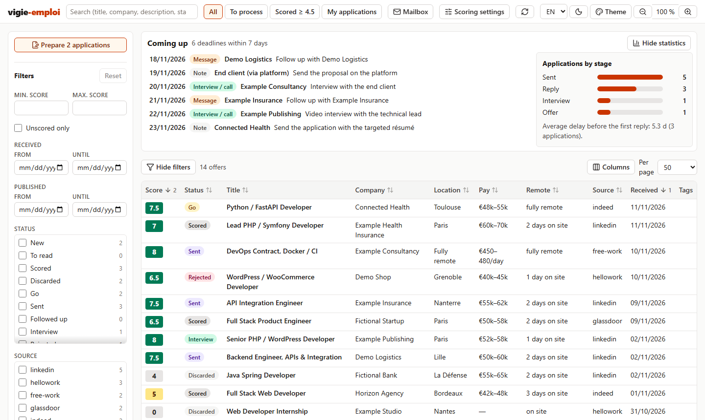
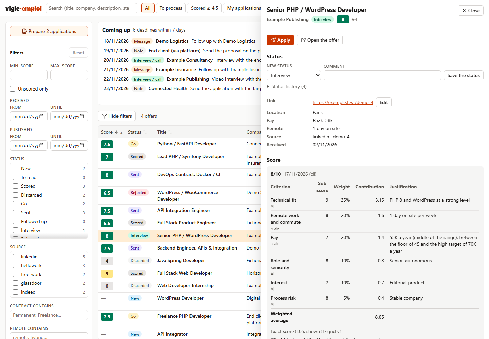
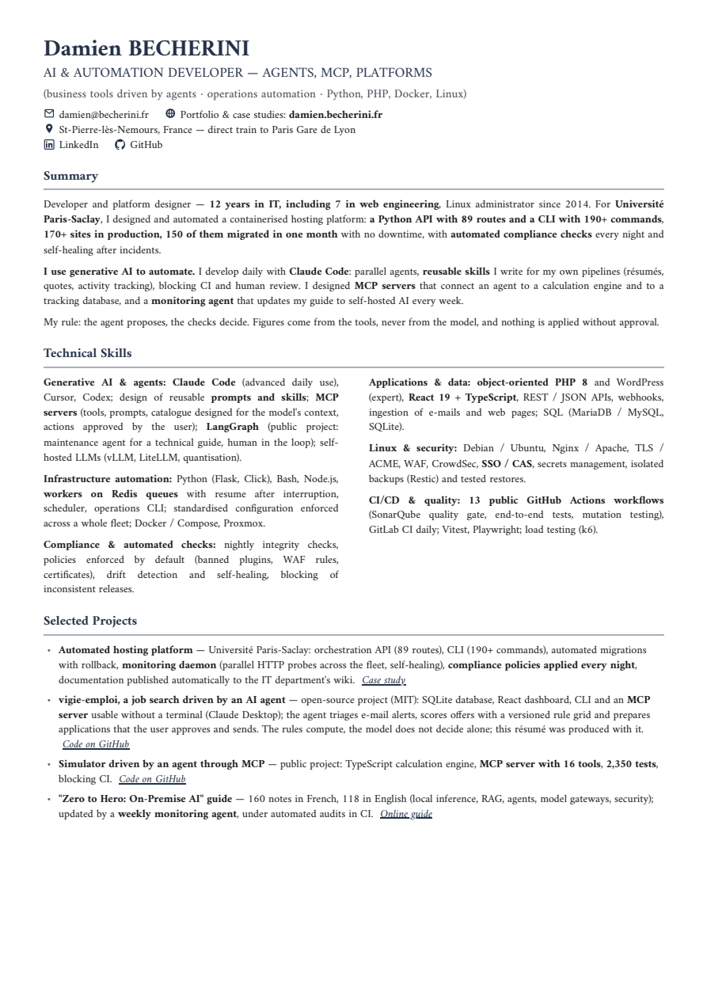
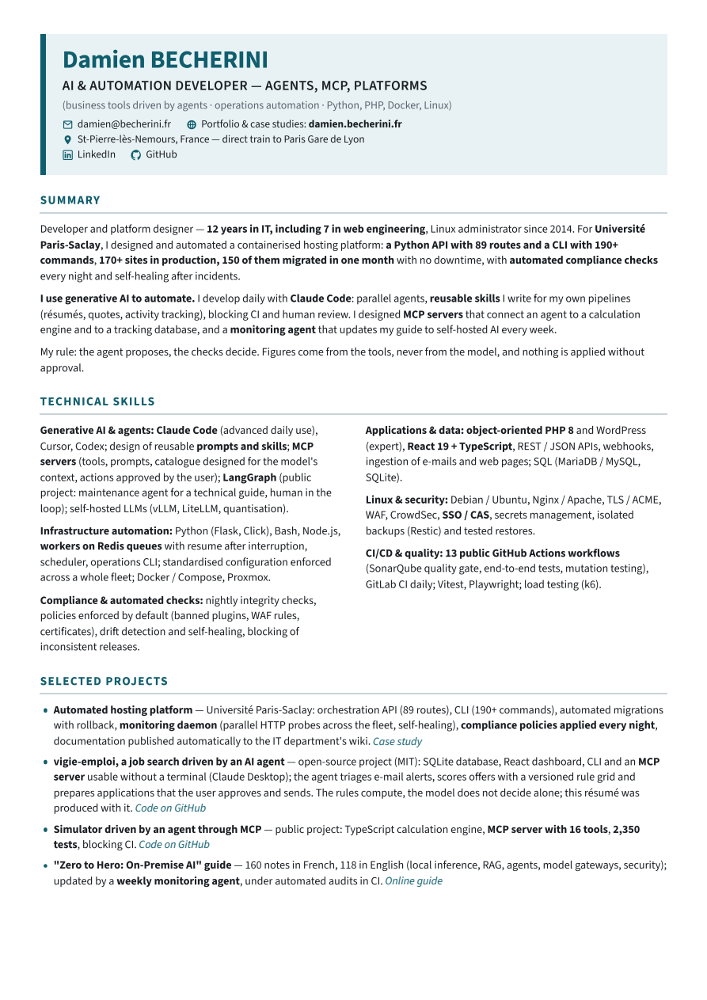
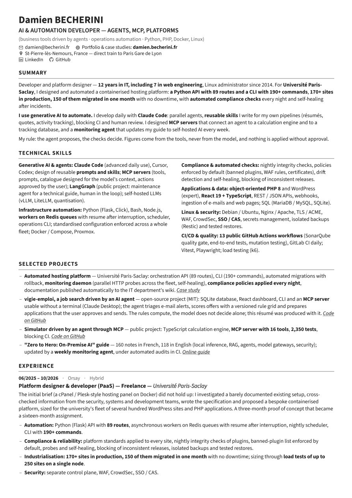
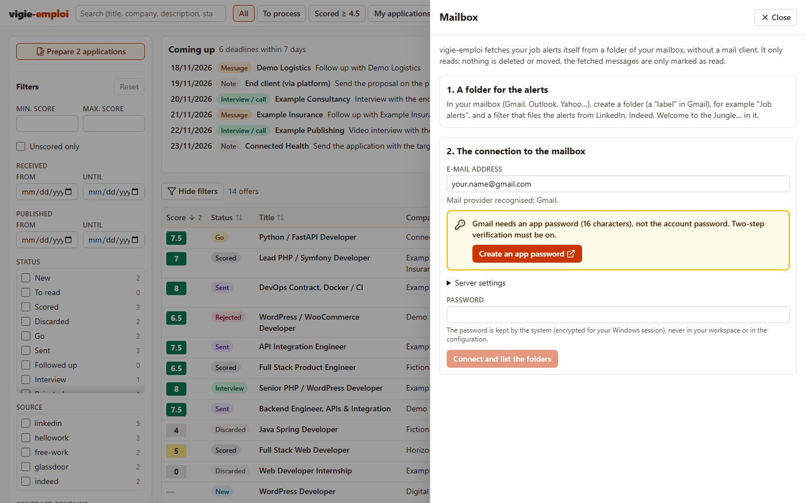

<div align="center">

# vigie-emploi

**English** · [Français](README.fr.md)

**Your job or freelance search, driven by your AI, without ever making you lie.**

[](LICENSE)
[](https://nodejs.org)
[](https://www.typescriptlang.org)
[](https://nodejs.org/api/sqlite.html)
[](https://modelcontextprotocol.io)
[](#requirements)
[](#privacy)

</div>

---

vigie-emploi is a local kit to look for a permanent job or freelance assignments with an AI agent (Claude Code, Cursor, Codex…). The AI triages the offers you receive through e-mail alerts, scores each one with **your** grid, prepares the applications you approve (application file, tailored résumé, message) and keeps track of the follow-up. Everything stays on your computer.

> **Built for the French job market first.** Job ads are recognised in the alerts of LinkedIn, Indeed, Glassdoor, Hellowork, Free-Work and Collective, and the file names inside your workspace are French (`candidatures/`, `DEMARRAGE.md`…). The application itself speaks English and French: `init` takes your system's language, and `--language en` or `--language fr` forces one. That language covers the AI instructions and workspace templates (your agent works and writes in it: résumés, messages, application files), the sample scoring grid, the MCP server, the dashboard and the CLI messages. The language selector in the dashboard header switches the dashboard only. Command names and statuses are English identifiers.

The name means "job lookout" (*vigie*, the sailor in the crow's nest who spots what matters and calls it out). Two promises:

- **it sorts for you**: the job alerts in your mailbox are fetched and read in a single pass when you start the triage; a transparent, adjustable scoring grid (weights, pay floor, remote work, blocking rules) only shows you the offers worth your time; and every follow-up has its date;
- **it never makes you lie**: the AI relies on an inventory of what you can and cannot claim, built with you during onboarding. It only writes in a résumé what you can defend in an interview. Application after application, you refine with it what makes you valuable and the message you want to convey, until the result truly sounds like you.

## How it works

```
e-mail alerts (.eml)  →  triage and scoring by the AI (your grid)  →  your "go"
        →  application file + tailored résumé (PDF, 2 pages) + message  →  sent by you  →  follow-up (journal, deadlines, reminders)
```

1. **Guided onboarding**: you drop your résumé (and the PDF export of your LinkedIn profile) into `a-deposer/`. The AI reads them, looks at your public pages if it can, then asks you small batches of questions: targets, background, evidence, what sets you apart, risks, things never to claim, conditions. From this it writes your **context** (`_CONTEXTE.md`), your **grid** and a first **résumé**, which you approve.
2. **Alert triage**: a mail filter files the alerts (LinkedIn, Indeed, Glassdoor, Hellowork, Free-Work…) in a folder that the application fetches itself (see [Automating alert intake](#automating-alert-intake)). The AI ingests them, discards off-target ones, scores the rest criterion by criterion (the application computes the score) and shows you the best offers.
3. **Applications**: on your "go", the AI prepares the application file, a tailored résumé that fits on two pages, and the message adapted to the form and its character limit. **You do the sending.**
4. **Follow-up**: you tell it what happened ("sent yesterday", "interview Thursday at 2 pm"); the AI keeps the journal, the deadlines and the tracking table.

The application **calls no AI model**: your agent reads and writes, the application keeps the state (SQLite database, web dashboard, CLI, MCP server).



*The dashboard (fictitious data): offers sorted by date received then by score, deadlines for the next seven days, applications by stage.*



*Offer details: each criterion, its sub-score, its weight and its contribution to the final score, with the AI's justification.*

### Résumés

Résumés are written in Markdown and rendered as two-page A4 PDFs, with three templates: "plain" (serif), "modern" (colour banner) and "compact" (single column, dense). The AI can also adapt the stylesheet to a model you show it.

<div align="center">
<a href="docs/examples/CV-damien-becherini-plain.pdf"></a>
<a href="docs/examples/CV-damien-becherini-modern.pdf"></a>
<a href="docs/examples/CV-damien-becherini-compact.pdf"></a>

<em>My own résumé, written with vigie-emploi and rendered with each of the three templates (first page; click to open the full PDF). Markdown source: <a href="docs/examples/CV-damien-becherini.md">docs/examples/CV-damien-becherini.md</a>.</em>
</div>

## Requirements

- **Node.js 24** or later, except with the Claude Desktop extension (it uses the Node built into the application).
- **Chrome, Edge or Chromium** (for PDF résumés).
- **An AI**: Claude Desktop (one-click extension, nothing else to install), or an agent that works in a folder: Claude Code preferably (MCP server and skills included); Cursor, Codex or another agent read the same instructions (`AGENTS.md`) and use the CLI.
- Optional: a **browser driven by the AI** with your sessions (for example Claude in Chrome), to read LinkedIn, Indeed or Glassdoor offers. Without it, you paste the offer text when the AI asks.

## Getting started

### One-click install (Claude Desktop)

1. Download the `vigie-emploi-<version>.mcpb` file (the repository's [Releases](https://github.com/DamienBecherini/vigie-emploi/releases) page).
2. Double-click it (or drag it into the Claude Desktop window, or **Settings → Extensions → Advanced settings → Install Extension…**), then click **Install**.
3. Choose the **workspace folder** (by default `vigie-emploi` in your home folder; it does not need to exist) and the **language**: `en` or `fr` (left empty, it is your system's language).
4. In a new conversation, ask "create my vigie-emploi workspace", or **+** button → vigie-emploi → **`onboarding`** prompt. Claude creates the workspace, asks you to drop your résumé into `a-deposer/`, then runs the onboarding.

No terminal and no Node to install: the extension contains the application and uses the Node built into Claude Desktop. To browse your job ads in the dashboard, ask Claude to open it (`open_dashboard` tool). Details: [docs/mcp.md](docs/mcp.md#claude-desktop).

### With Claude Code or another agent

Open Claude Code (or your agent) in any folder and paste this prompt, without changing anything:

```text
Install vigie-emploi for my job search (https://github.com/DamienBecherini/vigie-emploi): run "npx -y vigie-emploi@latest init --language en", which creates the vigie-emploi folder in my home folder, then read AGENTS.md and DEMARRAGE.md in that folder and run the onboarding with me. If Node.js 24 is missing, explain how to install it.
```

The agent creates your workspace in `~/vigie-emploi` (your home folder, on Windows, macOS and Linux), then starts the onboarding: it asks you to drop your résumé in `~/vigie-emploi/a-deposer/` and asks its questions. For another folder, add its path after `init` in the prompt (`… init D:/job-search --language en`). Onboarding takes two sessions of about half an hour each; for the second one and the following ones, open Claude Code in the workspace folder (`cd ~/vigie-emploi` then `claude`) and accept the "vigie-emploi" MCP server.

By hand, without a prompt: `npx vigie-emploi init --language en` (or `npx vigie-emploi init <folder> --language en`) creates the workspace and prints the onboarding prompt; then open your AI in that folder and paste it. The workspace keeps the version used (`npx -y vigie-emploi@<version>`, in `.mcp.json` and in the AI's instructions). For a permanently installed command: `npm install -g vigie-emploi`, then `vigie-emploi init --language en`. To contribute, install from the repository (see [Installation](docs/reference.md#installation)).

`init` options: `--template modern` or `compact` to change the résumé template; `--language en` or `--language fr` to choose the language instead of taking your system's (AI instructions and workspace templates, sample grid, MCP server, dashboard and CLI; command and status names are the same in every language, the workspace's file names stay in French).

## Automating alert intake

The AI processes the job alerts that reach the application. The simplest way: **the application fetches a folder of your mailbox itself** (IMAP), on Windows, macOS or Linux, without a mail client.

1. Create **alerts** on the job sites you use (LinkedIn, Indeed, Glassdoor, Hellowork, Free-Work…), with your keywords.
2. In your mailbox, create a **folder** (a label in Gmail), for example "Job alerts", and a **filter** that files the alerts in it (condition: the sender of each site).
3. Connect the mailbox: **"Mailbox"** button of the dashboard, or `vigie-emploi mail setup` in a terminal. Address, password, choice of the folder.
4. Then ask your AI to "process the e-mails": it fetches the folder, then sorts and scores the new offers.



The application only reads: nothing is deleted or moved in the mailbox, the fetched messages are only marked as read (`markSeen: false` to avoid it). Each message is fetched once; the first fetch is limited to the last 14 days.

| Provider | Password to type |
| --- | --- |
| Gmail, Yahoo, iCloud | an **app password** (two-step verification required; Gmail: https://myaccount.google.com/apppasswords) |
| Most other providers | the usual password |
| Outlook.com, Hotmail, Microsoft 365 | not supported yet: forward the alerts to another mailbox, or use a method below |
| Other | the mailbox's, with the IMAP server given by your provider |

The password is handed to the system, never written in the workspace or in the configuration: encrypted for your Windows session (DPAPI, in `%APPDATA%\vigie-emploi`), macOS keychain, desktop keyring on Linux (Secret Service), or otherwise a file readable by you alone in `~/.config/vigie-emploi`. The `VIGIE_EMPLOI_MAIL_PASSWORD` variable replaces it when set. The settings (address, server, folder) go in the `mail` section of `vigie-emploi.config.json`.

### Other methods

The AI also processes any `.eml` file dropped in the workspace's `emails/` folder:

- **drag** the alerts from your mail client, once a day is enough;
- **Thunderbird and the [FiltaQuilla](https://addons.thunderbird.net/thunderbird/addon/filtaquilla/) add-on**: enable the "Save Message as File" action in FiltaQuilla's options, then create a filter (Tools → Message Filters) that, for the alert senders, saves the message in `emails/` when getting new mail;
- any other rule or script able to save a message as `.eml` into `emails/`.

## Privacy

Your workspace (résumés, context, database, applications) stays on your disk. Nothing is sent anywhere except to the AI you use. The application only downloads the public pages of Hellowork and Free-Work offers; it never reads LinkedIn, Indeed or Glassdoor by script. If you connect your mailbox, it only reads the chosen folder, directly from your computer, and keeps the password in the system keychain.

## Reference

[`docs/reference.md`](docs/reference.md) describes the application in detail: installation, creating the workspace, PDF résumés, configuration, commands, scoring grid, dashboard, generated tracking file, journal and deadlines, development.

See also [`docs/mcp.md`](docs/mcp.md) (connecting an AI through the MCP server), [`AGENTS.md`](AGENTS.md) (how an AI drives the application), [`docs/adding-a-language.md`](docs/adding-a-language.md), the architecture decisions in [`docs/adr/`](docs/adr/) and the [changelog](CHANGELOG.md).

## License

Code under the MIT license (see `LICENSE`). Résumé template fonts under the SIL Open Font License: Amiri ("plain" template) and Source Sans 3 ("modern" and "compact" templates); license text in each template's `fonts/` folder.
