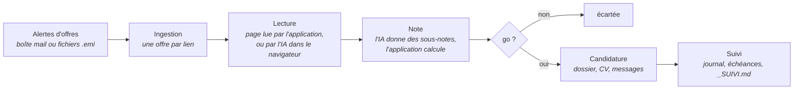
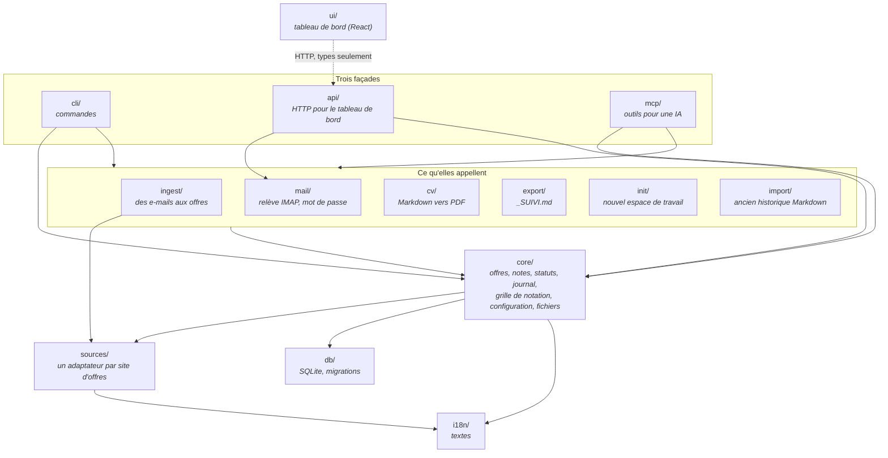
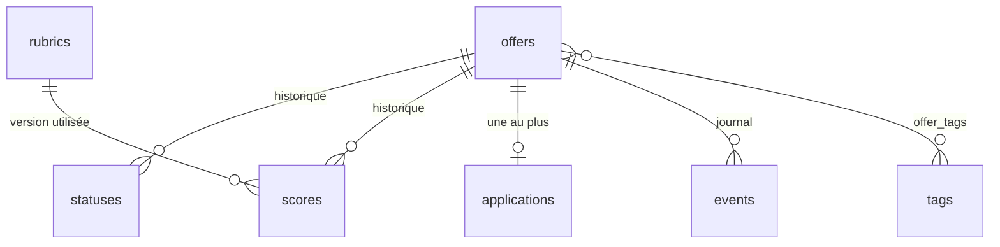

# vigie-emploi : comment le code s'articule

**Un guide de lecture pour les développeurs : les modules, les données, la note, les trois façades (ligne de commande, API, serveur MCP), les sites d'offres, et pourquoi c'est construit ainsi.**

[English](code.md) · **Français** · [README](../README.fr.md) · [Référence](reference.fr.md) · [Contribuer](../CONTRIBUTING.fr.md)

---

Environ 13 000 lignes de TypeScript dans [`src/`](../src/) (dont 1 500 pour les dictionnaires de textes) et 6 000 dans [`ui/src/`](../ui/src/) pour le tableau de bord. Node 24 exécute le TypeScript de `src/` tel quel, sans étape de construction pendant le développement. La base est un fichier SQLite ouvert avec `node:sqlite`, qui fait partie de Node. L'application n'appelle aucun modèle d'IA : une IA la pilote de l'extérieur, par la ligne de commande ou par le serveur MCP. Environ 440 tests tournent sans réseau, sans boîte mail et sans navigateur, sous Linux, Windows et macOS, à chaque push ([`.github/workflows/tests.yml`](../.github/workflows/tests.yml)).

Les noms du code (fichiers, fonctions, tables, statuts) sont en anglais ; ce guide les cite tels quels.

## Le travail, vu par l'utilisateur

L'**espace de travail** de l'utilisateur est un dossier : ses consignes pour l'IA, son contexte, ses CV, un dossier par candidature, et la base dans `data/`. L'application tient l'état des offres (lesquelles existent, leur note, leur statut, ce qui s'est passé et ce qui est à faire) ; les documents restent des fichiers que l'utilisateur et l'IA lisent et écrivent. Une IA lit et rédige ; l'utilisateur décide (« go ») et envoie ses candidatures.

## Les modules et leurs dépendances

| Dossier | Ce qu'il contient |
|---|---|
| [`src/core/`](../src/core/) | Tout ce que les trois façades partagent : les offres et leurs historiques ([`offers.ts`](../src/core/offers.ts)), la liste et ses filtres ([`queries.ts`](../src/core/queries.ts)), les opérations que demandent une IA ou l'utilisateur ([`actions.ts`](../src/core/actions.ts)), la grille de notation ([`rubric.ts`](../src/core/rubric.ts) et [`rubric/`](../src/core/rubric/), [`rubric-storage.ts`](../src/core/rubric-storage.ts)), le journal ([`events.ts`](../src/core/events.ts)), la configuration ([`config.ts`](../src/core/config.ts)), l'accès aux fichiers de l'espace de travail ([`access-files.ts`](../src/core/access-files.ts), [`files.ts`](../src/core/files.ts)), les erreurs ([`errors.ts`](../src/core/errors.ts)). |
| [`src/sources/`](../src/sources/) | Un adaptateur par site d'offres et leur registre. Rien d'autre ne nomme un site. |
| [`src/ingest/`](../src/ingest/) | Lecture d'un e-mail d'alerte, ingestion de la boîte de réception, téléchargement d'une page publique. |
| [`src/mail/`](../src/mail/) | Relève IMAP (lecture seule), messageries connues, mot de passe de la boîte gardé par le système. |
| [`src/cli/`](../src/cli/) | Point d'entrée, lecture des options, un fichier par groupe de commandes dans [`commands/`](../src/cli/commands/). |
| [`src/api/`](../src/api/) | Serveur HTTP local : un module par ressource dans [`routes/`](../src/api/routes/), notifications, arrêt automatique. |
| [`src/mcp/`](../src/mcp/) | Serveur MCP : un fichier d'outils par domaine dans [`tools/`](../src/mcp/tools/), les outils d'un client sans accès au disque ([`workspace.ts`](../src/mcp/workspace.ts)), ses propres textes. |
| [`src/cv/`](../src/cv/), [`src/export/`](../src/export/), [`src/init/`](../src/init/), [`src/import/`](../src/import/) | CV en PDF, fichier de suivi généré, création d'un espace de travail, reprise d'un historique tenu en Markdown. |
| [`src/db/`](../src/db/), [`migrations/`](../migrations/) | Ouverture de la base et migrations SQL numérotées. |
| [`src/i18n/`](../src/i18n/) | Textes de la ligne de commande, de l'API et des fichiers générés ; libellés des identifiants. |
| [`ui/src/`](../ui/src/) | Le tableau de bord : composants, hooks, client de l'API, ses propres textes. |

La ligne de commande lance aussi les deux autres façades : `vigie-emploi serve` pour le tableau de bord, `vigie-emploi mcp` pour le serveur MCP.

Deux règles gardent l'ensemble lisible. Une façade ne contient aucune règle du métier : une commande, une route et un outil qui font la même chose appellent la même fonction de `core/`. Et `core/` ne sait rien des façades : il reçoit une base et des valeurs, renvoie des valeurs, et lève une erreur avec un code.

`sources/` utilise trois feuilles de `core/` (HTML vers texte, dates et montants, textes). `core/links.ts` et `core/actions.ts` interrogent le registre de `sources/` ; aucun adaptateur n'importe un module qui importe le registre.

## Les données

La base est `data/vigie-emploi.sqlite` dans l'espace de travail. Le schéma est la somme des fichiers de [`migrations/`](../migrations/) ; `PRAGMA user_version` dit lesquels sont appliqués, et [`db/database.ts`](../src/db/database.ts) applique les suivants, chacun dans une transaction, à l'ouverture de la base.

| Table | Une ligne est | À savoir |
|---|---|---|
| `offers` | Une offre. | Unique par (`source`, `site_id`) : c'est par cette paire qu'une offre vue deux fois est reconnue. `status` et `score` sont des copies de la dernière ligne des deux historiques, gardées pour trier et filtrer. |
| `statuses` | Un changement de statut, avec son commentaire et son auteur. | Jamais modifiée. Une fois l'offre suivie (« go » et au-delà), un « new » ou un « scored » plus récent venu d'une alerte ne l'emporte plus (`ORDER_STATUSES` dans [`offers.ts`](../src/core/offers.ts)). |
| `scores` | Une note donnée à une offre. | Garde la saisie (sous-notes, chiffres, règles signalées), la décomposition calculée et la version de la grille. Une renotation recalcule à partir de la saisie. |
| `rubrics` | Une version de la grille de notation. | La grille en vigueur est aussi le fichier `profil/grille.json`, pour que l'utilisateur puisse la lire et la versionner. |
| `applications` | Ce qui a été envoyé pour une offre : dossier, CV, canal, prochaine action. | |
| `events` | Une ligne datée du journal : message, entretien, test, proposition, décision, note. | Un événement dans le futur, ou passé et non fait, est une échéance (vue `deadlines`). Les fichiers sont des chemins relatifs à l'espace de travail. |
| `mailbox_state` | Le dernier message relevé dans un dossier de la boîte mail. | Un message est relevé une seule fois. |

Ce qui est enregistré porte des identifiants et des valeurs, jamais des phrases : un statut est `followed-up`, un drapeau de note est `{ code: 'sub_floor', params: { amount: 38, unit: 'salary' } }`. La phrase s'écrit à l'affichage, dans la langue de celui qui lit ([`i18n/labels.ts`](../src/i18n/labels.ts)). Un test vérifie que le code de l'application ne contient aucune phrase française hors des dictionnaires ([`tests/codes.test.ts`](../tests/codes.test.ts)).

## La note

L'IA ne donne jamais la note finale. Elle note quelques critères de 0 à 10, donne les chiffres qu'elle a lus (jours sur site, rémunération) et nomme les règles bloquantes qui s'appliquent. L'application fait le reste dans [`core/rubric/computation.ts`](../src/core/rubric/computation.ts), avec des fonctions pures qui ne touchent ni au disque ni à la base :

1. Les critères de type `computation` (télétravail, rémunération) tirent leur sous-note des barèmes de la grille. Les chiffres viennent de la saisie de l'IA, à défaut des champs de l'offre ([`remote-text.ts`](../src/core/rubric/remote-text.ts) lit « 3 j sur site »). Inconnu : la valeur neutre de la grille, et un drapeau.
2. Les critères de type `ai` prennent la sous-note de l'IA. Absente : 5, et un drapeau.
3. Moyenne pondérée, les poids étant ramenés à une somme de 1.
4. Règles : une règle signalée met la note à zéro ou la plafonne ; une règle `criterion_cap` plafonne la note à la sous-note d'un critère quand celle-ci est sous un seuil.
5. Arrondi au demi-point.

Le résultat est une décomposition (la ligne de chaque critère, les règles appliquées, les drapeaux) enregistrée avec la note, que le tableau de bord affiche telle quelle. Comme la saisie est enregistrée elle aussi, un changement de grille peut montrer son effet sur toutes les offres notées avant d'être enregistré (`previewRubric` dans [`rubric-storage.ts`](../src/core/rubric-storage.ts)), puis les renoter.

La grille elle-même est un schéma Zod ([`rubric/schema.ts`](../src/core/rubric/schema.ts)) ; [`rubric.ts`](../src/core/rubric.ts) est le point d'entrée qui liste ce que le reste du code peut utiliser.

## Trois façades, un seul cœur

| | Ligne de commande | API | Serveur MCP |
|---|---|---|---|
| Pour | Une IA qui a un terminal, des scripts, l'utilisateur | Le tableau de bord | Une IA sans terminal (Claude Desktop), ou avec |
| Entrée | [`cli/main.ts`](../src/cli/main.ts) | [`api/server.ts`](../src/api/server.ts) | [`mcp/server.ts`](../src/mcp/server.ts) |
| Lit ce qu'elle reçoit avec | `analyze()` ([`cli/options.ts`](../src/cli/options.ts)) : `parseArgs` de Node, valeurs typées d'après la définition des options | `body(c, schema)` ([`api/bodies.ts`](../src/api/bodies.ts)) : un schéma Zod par route | Le schéma Zod de chaque outil, qui est aussi ce que lit l'IA |
| Une erreur attendue devient | Son message sur la sortie d'erreur, code de sortie 1 ; avec `--json`, `{ ok, error, code }` | `{ ok: false, error, code }` avec le statut du code | Un résultat d'erreur que l'IA peut lire ; le serveur continue |
| Un défaut devient | Sa pile | 500, pile sur la sortie d'erreur | Le message pour l'IA, pile sur la sortie d'erreur |

Le serveur MCP a deux tâches de plus. Il démarre sans espace de travail, pour qu'une IA lancée sans configuration puisse proposer d'en créer un ([`mcp/state.ts`](../src/mcp/state.ts)). Et pour un client qui ne lit ni le disque ni un terminal, il donne des outils pour lister, lire et écrire les fichiers de l'espace de travail, produire un CV en PDF et ouvrir le tableau de bord ([`mcp/workspace.ts`](../src/mcp/workspace.ts), [`mcp/dashboard.ts`](../src/mcp/dashboard.ts)). Ses grandes réponses sont plafonnées pour qu'un tel client puisse les lire en entier ([`mcp/presentation.ts`](../src/mcp/presentation.ts)).

## Sites d'offres

Ce que l'application sait d'un site tient dans un fichier de [`src/sources/`](../src/sources/), un objet de type `SourceAdapter` ([`adapter.ts`](../src/sources/adapter.ts)) :

| Champ | Dit |
|---|---|
| `id` | L'identifiant enregistré dans `offers.source`. |
| `identify(url)` | Si un lien est une offre du site, son identifiant sur le site et son adresse sans paramètres de suivi. |
| `browserReading` | Qui ouvre la page quand il n'y a pas de description : l'IA (`agent`), ou l'utilisateur (`human`) sur un site qui bloque un navigateur piloté. |
| `extract(page)` | Facultatif. Le détail lu dans la page publique. C'est sa présence qui fait télécharger la page par l'ingestion. |
| `titleInEmail`, `splitLinkText` | Facultatifs. Ce que les e-mails d'alerte du site font différemment. |

[`index.ts`](../src/sources/index.ts) liste les adaptateurs ; `identifyOffer(url)` essaie un lien contre chacun. L'ingestion, la lecture des e-mails et la liste des offres à lire interrogent le registre et ne comparent jamais le nom d'un site.

LinkedIn, Indeed et Glassdoor n'ont pas d'`extract` : leurs conditions d'utilisation et leurs protections excluent qu'un programme télécharge leurs pages, donc l'IA les lit dans le navigateur de l'utilisateur, ou l'utilisateur le fait. Hellowork et Free-Work publient un `JobPosting` de schema.org, lu par [`job-posting.ts`](../src/sources/job-posting.ts), qu'un nouvel adaptateur peut réutiliser.

**Ajouter un site** : écrire son adaptateur (partir de [`hellowork.ts`](../src/sources/hellowork.ts), 18 lignes), l'ajouter à `ADAPTERS`, et lui donner un bloc dans [`tests/sources.test.ts`](../tests/sources.test.ts), avec des liens qui sont des offres et des liens qui n'en sont pas. Ne définir `extract` que si les conditions du site le permettent. Un `id`, une fois publié, ne change plus : il est dans les bases des utilisateurs.

## Erreurs, entrées, textes

**Erreurs.** Ce que l'application attend (une mauvaise saisie, quelque chose qui n'existe pas, un accès refusé) est une `AppError` avec un code ([`core/errors.ts`](../src/core/errors.ts)). Chaque façade traduit le code en sa propre réponse ; aucune ne lit le texte du message.

| Code | Veut dire | HTTP |
|---|---|---|
| `invalid` | La saisie est fausse. | 400 |
| `not-found` | L'offre, l'événement, la version n'existe pas. | 404 |
| `forbidden` | Un chemin hors de l'espace de travail, une écriture interdite. | 403 |
| `not-configured` | Pas d'espace de travail, pas de boîte mail. | 400 |
| `file-not-found` | Le fichier de configuration nommé n'existe pas. | 404 |
| `language-unknown` | La langue demandée n'a pas de dictionnaire. | 400 |

Tout le reste de ce qui est levé est un défaut du programme : il montre sa pile et, en HTTP, répond 500.

**Entrées.** Ce qui vient de l'extérieur passe par un schéma Zod là où il entre : la grille, une note (une seule définition, `schemaInputBatch` dans [`core/scoring.ts`](../src/core/scoring.ts), à laquelle le serveur MCP ajoute ses descriptions), un événement, le corps de chaque requête, le fichier de configuration. Les types sont déduits des schémas, et le tableau de bord importe ses types depuis le serveur ([`ui/src/api.ts`](../ui/src/api.ts)) : un champ renommé côté serveur est une erreur de compilation dans l'interface.

**Textes.** Trois jeux de dictionnaires, un par lecteur :

- [`src/i18n/`](../src/i18n/) pour l'utilisateur en ligne de commande, dans les messages de l'API et dans les fichiers générés : `t(key)` dans la langue du processus, `tl(language, key)` dans une langue donnée.
- [`src/mcp/i18n/`](../src/mcp/i18n/) pour le serveur MCP : ce que seule l'IA lit est en anglais, ce qui est montré tel quel à l'utilisateur suit sa langue ([`mcp/texts.ts`](../src/mcp/texts.ts)).
- [`ui/src/i18n/`](../ui/src/i18n/) pour le tableau de bord.

Tous les dictionnaires d'un jeu ont le même type : une traduction manquante est une erreur de compilation. Les noms des commandes, des options, des outils, des statuts et des champs JSON sont des identifiants anglais qui ne changent pas avec la langue. Un fichier sans suffixe de langue est en anglais et les autres portent le leur (`README.fr.md`, `scaffold-fr/`) ; un espace de travail créé sans `--language` prend la langue du système. [Ajouter une langue](adding-a-language.fr.md) donne les étapes.

## L'espace de travail et ses fichiers

La configuration est résolue une fois, dans `loadConfig` ([`core/config.ts`](../src/core/config.ts)) : le dossier de données vient de `--data`, puis de `VIGIE_EMPLOI_DATA`, puis du fichier de configuration ; le fichier, de `--config`, puis de `VIGIE_EMPLOI_CONFIG`, puis du dossier courant, du dossier de données, du dossier de l'application. Le code ne contient rien de personnel : tout ce qui concerne l'utilisateur est dans son espace de travail.

Une IA qui atteint l'espace de travail par le serveur MCP, et le tableau de bord qui affiche un fichier, sont tenus à l'intérieur du dossier ([`access-files.ts`](../src/core/access-files.ts), [`files.ts`](../src/core/files.ts)) : chemins relatifs seulement, pas de `..`, pas de segment caché, jamais `data/` (la base), et le chemin doit rester à l'intérieur une fois les liens symboliques résolus. L'outil d'écriture accepte une liste fermée d'extensions et ne supprime jamais. La page qui affiche un fichier Markdown interdit les scripts, les connexions et les cadres ([`api/file.ts`](../src/api/file.ts)). [`tests/security.test.ts`](../tests/security.test.ts) et [`tests/access-files.test.ts`](../tests/access-files.test.ts) contiennent les cas.

Le mot de passe de la boîte mail n'est jamais dans l'espace de travail : DPAPI sous Windows, le trousseau de macOS ou le Secret Service de Linux le gardent ([`mail/secret.ts`](../src/mail/secret.ts)), et il leur parvient par l'entrée standard, jamais par une ligne de commande.

## Le tableau de bord

`vigie-emploi serve` lance un serveur Hono sur localhost, qui sert l'API JSON et l'interface compilée. Il ne répond qu'aux requêtes adressées à localhost et refuse les écritures venues d'une autre origine : c'est ce qui empêche une page web ouverte dans le même navigateur de lire ou de modifier les données ([`api/server.ts`](../src/api/server.ts)).

La base est aussi écrite par la ligne de commande et par le serveur MCP d'une IA, dans d'autres processus. Le serveur surveille le fichier de la base et compare `PRAGMA data_version`, puis pousse une notification à l'interface par Server-Sent Events ([`api/broadcast.ts`](../src/api/broadcast.ts)) ; l'interface recharge ce qu'elle affiche. Rien n'interroge en boucle.

L'interface ([`ui/src/`](../ui/src/)) est en React, avec TanStack Query pour les données et TanStack Table pour la liste :

- Les filtres, le tri, la page et l'offre ouverte sont dans l'URL ([`state.ts`](../ui/src/state.ts)) : une vue se met en favori et survit à un rechargement. Les préférences (colonnes, thème, langue) sont dans `localStorage`.
- Le tri, le filtrage et la pagination sont faits par le serveur ([`core/queries.ts`](../src/core/queries.ts)) ; l'interface ne détient qu'une page.
- Les clés du cache sont construites à un seul endroit ([`queryKeys.ts`](../ui/src/queryKeys.ts)).
- [`App.tsx`](../ui/src/App.tsx) met la page en place ; le tableau, le panneau de détail, le journal et les réglages de la grille sont des composants ; ce que la page fait dans le temps (en-tête collant, recherche, défilement) est dans [`hooks/`](../ui/src/hooks/).

L'interface importe des types de `src/`, et seulement des types : rien du serveur n'arrive dans le bundle. C'est pour cela que [`ui/tsconfig.json`](../ui/tsconfig.json) connaît les types de Node.

## Les choix, et pourquoi

- **Aucun appel à une IA dans l'application.** L'utilisateur a déjà une IA, avec son abonnement, ses outils et son navigateur. L'application lui donne un état et des règles ; elle ne coûte rien à faire tourner et fonctionne avec une autre IA. [ADR 0002](adr/0002-mcp-and-tracker.fr.md), [ADR 0005](adr/0005-agent-buttons-and-notifications.fr.md).
- **L'application calcule la note.** Une note donnée entière par une IA dérive d'un lot à l'autre et ne s'explique pas. Des sous-notes et une grille donnent le même résultat pour la même saisie, une décomposition à montrer, et une renotation quand la grille change. [ADR 0004](adr/0004-scoring-grid.fr.md).
- **Des fichiers pour les documents, une base pour l'état.** Les CV, les messages et les dossiers de candidature sont lus et modifiés par l'utilisateur et par l'IA : ils restent des fichiers. Ce qui doit être trié, filtré et compté est dans SQLite. Le fichier de suivi `_SUIVI.md` est généré depuis la base, jamais modifié à la main. [ADR 0002](adr/0002-mcp-and-tracker.fr.md), [ADR 0003](adr/0003-journal-and-deadlines.fr.md).
- **Des historiques, pas des champs écrasés.** Un statut et une note s'ajoutent ; la valeur en vigueur est la dernière ligne. Les imports peuvent être rejoués, et « que s'est-il passé pour cette offre » a une réponse.
- **Du TypeScript exécuté par Node, SQLite fourni par Node.** Aucune étape de construction pour essayer une modification, aucun module natif à compiler sur la machine de l'utilisateur. Le prix : une syntaxe limitée à ce que Node sait effacer (pas d'enum, pas de propriétés déclarées dans les paramètres d'un constructeur) et des imports écrits avec `.ts` ; le paquet npm livre du JavaScript compilé, parce que Node ne retire pas les types sous `node_modules`. [ADR 0001](adr/0001-technical-choices.fr.md).
- **Trois façades minces.** La même opération doit exister pour un terminal, pour un navigateur et pour une IA sans terminal. Garder les règles dans `core/` est ce qui garde les trois d'accord.
- **Un adaptateur par site, des erreurs à code, des codes au lieu de phrases.** Les trois décisions de la refonte 0.7, chacune pour supprimer un endroit où le code comparait des chaînes. [ADR 0006](adr/0006-redesign-0-7.fr.md).
- **Les pages de LinkedIn, d'Indeed et de Glassdoor ne sont jamais téléchargées.** Leurs conditions l'interdisent et leurs protections rendent la chose peu fiable ; l'IA les lit dans la session de navigateur de l'utilisateur.

## Les tests

`npm run check` lance ce que lance la CI : typecheck (serveur et interface), Biome, build, tests. `npm run coverage` mesure la couverture de `src/` et échoue sous son plancher ([`vitest.config.ts`](../vitest.config.ts)).

Les tests sont dans [`tests/`](../tests/), un fichier par sujet, avec des données fictives dans [`tests/fixtures/`](../tests/fixtures/). Ils construisent une base en mémoire ou un espace de travail dans un dossier temporaire, et appellent le code comme le ferait un utilisateur : les fonctions du cœur, les commandes par `main()`, l'API par `app.request()`, le serveur MCP par le transport en mémoire du SDK. Un serveur IMAP en mémoire tient lieu de boîte mail. La langue du système est fixée au français pour l'exécution ([`tests/setup.ts`](../tests/setup.ts)) : les résultats ne dépendent pas de la machine.

Quelques tests gardent le projet plutôt qu'une fonction : les liens de la documentation et la présence de chaque traduction ([`docs.test.ts`](../tests/docs.test.ts)), ce que livre le paquet npm ([`package.test.ts`](../tests/package.test.ts)), le fichier de verrouillage ([`lockfile.test.ts`](../tests/lockfile.test.ts)), pas de français hors des dictionnaires ([`codes.test.ts`](../tests/codes.test.ts)).

## Par où commencer la lecture

| Pour comprendre | Lire |
|---|---|
| Ce qu'est une offre et comment son état change | [`core/offers.ts`](../src/core/offers.ts), puis [`migrations/0005_english.sql`](../migrations/0005_english.sql) pour le schéma |
| Le trajet d'un e-mail d'alerte | [`ingest/ingest.ts`](../src/ingest/ingest.ts), de haut en bas |
| La note | [`core/rubric/computation.ts`](../src/core/rubric/computation.ts) (`computeScore`), puis [`tests/rubric.test.ts`](../tests/rubric.test.ts) |
| Comment une opération est offerte trois fois | `scoreOffers` dans [`core/actions.ts`](../src/core/actions.ts), puis ses appelants dans [`cli/commands/scoring.ts`](../src/cli/commands/scoring.ts), [`api/routes/offers.ts`](../src/api/routes/offers.ts) et [`mcp/tools/scoring.ts`](../src/mcp/tools/scoring.ts) |
| Ce qui est dit à une IA | Les consignes du serveur et les descriptions des outils dans [`mcp/i18n/en.ts`](../src/mcp/i18n/en.ts), et [`AGENTS.fr.md`](../AGENTS.fr.md) |
| Le tableau de bord | [`ui/src/App.tsx`](../ui/src/App.tsx), puis [`components/OffersTable.tsx`](../ui/src/components/OffersTable.tsx) |
