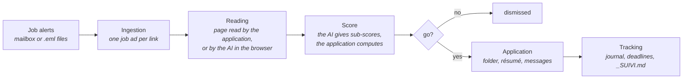
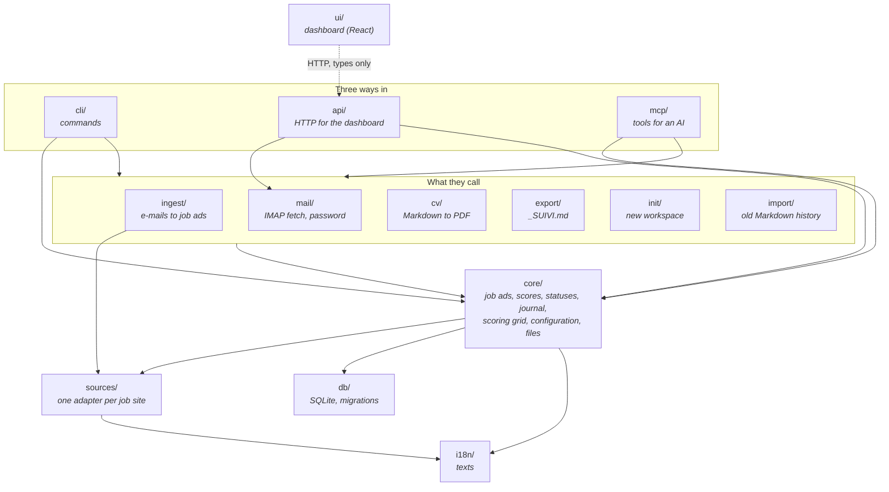
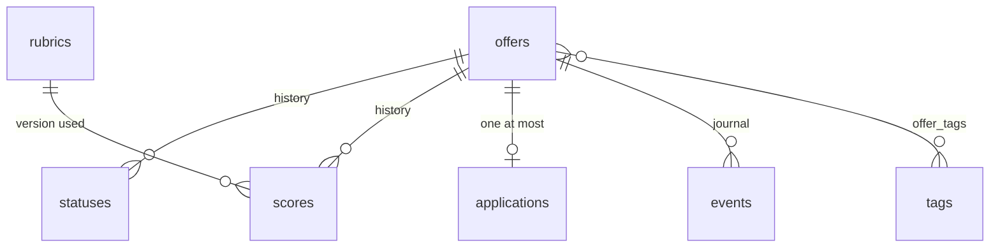

# vigie-emploi: how the code fits together

**A reading guide for developers: the modules, the data, the score, the three ways in (command line, API, MCP server), the job sites, and why it is built this way.**

**English** · [Français](code.fr.md) · [README](../README.md) · [Reference](reference.md) · [Contributing](../CONTRIBUTING.md)

---

About 13,000 lines of TypeScript in [`src/`](../src/) (1,500 of them are the dictionaries of texts) and 6,000 in [`ui/src/`](../ui/src/) for the dashboard. Node 24 runs the TypeScript of `src/` as it is, with no build step during development. The database is one SQLite file opened with `node:sqlite`, which is part of Node. The application calls no AI model: an AI drives it from outside, through the command line or the MCP server. About 440 tests run without a network, a mailbox or a browser, on Linux, Windows and macOS, on every push ([`.github/workflows/tests.yml`](../.github/workflows/tests.yml)).

## The work, from the user's side

The user's **workspace** is a folder: their instructions for the AI, their context, their résumés, one folder per application, and the database in `data/`. The application keeps the state of the job ads (which ones exist, their score, their status, what happened and what is due); the documents stay files that the user and the AI read and write. An AI does the reading and the writing; the user decides ("go") and sends the applications.

## Modules and their dependencies

| Folder | What it holds |
|---|---|
| [`src/core/`](../src/core/) | Everything the three ways in share: job ads and their histories ([`offers.ts`](../src/core/offers.ts)), the list with its filters ([`queries.ts`](../src/core/queries.ts)), the operations an AI or the user asks for ([`actions.ts`](../src/core/actions.ts)), the scoring grid ([`rubric.ts`](../src/core/rubric.ts) and [`rubric/`](../src/core/rubric/), [`rubric-storage.ts`](../src/core/rubric-storage.ts)), the journal ([`events.ts`](../src/core/events.ts)), the configuration ([`config.ts`](../src/core/config.ts)), the access to the workspace files ([`access-files.ts`](../src/core/access-files.ts), [`files.ts`](../src/core/files.ts)), the errors ([`errors.ts`](../src/core/errors.ts)). |
| [`src/sources/`](../src/sources/) | One adapter per job site and their registry. Nothing else names a site. |
| [`src/ingest/`](../src/ingest/) | Reading of an alert e-mail, ingestion of the inbox, download of a public page. |
| [`src/mail/`](../src/mail/) | IMAP fetch (read only), known providers, mailbox password kept by the system. |
| [`src/cli/`](../src/cli/) | Entry point, reading of the options, one file per group of commands in [`commands/`](../src/cli/commands/). |
| [`src/api/`](../src/api/) | Local HTTP server: one module per resource in [`routes/`](../src/api/routes/), notifications, automatic stop. |
| [`src/mcp/`](../src/mcp/) | MCP server: one file of tools per domain in [`tools/`](../src/mcp/tools/), the tools of a client without disk access ([`workspace.ts`](../src/mcp/workspace.ts)), its own texts. |
| [`src/cv/`](../src/cv/), [`src/export/`](../src/export/), [`src/init/`](../src/init/), [`src/import/`](../src/import/) | Résumé as PDF, generated tracking file, creation of a workspace, import of a history kept in Markdown. |
| [`src/db/`](../src/db/), [`migrations/`](../migrations/) | Opening of the database and numbered SQL migrations. |
| [`src/i18n/`](../src/i18n/) | Texts of the command line, the API and the generated files; labels of the identifiers. |
| [`ui/src/`](../ui/src/) | The dashboard: components, hooks, client of the API, its own texts. |

The command line is also what starts the other two: `vigie-emploi serve` for the dashboard, `vigie-emploi mcp` for the MCP server.

Two rules keep this readable. A way in holds no rule of the domain: a command, a route and a tool that do the same thing call the same function of `core/`. And `core/` knows nothing of the ways in: it receives a database and values, returns values, and throws an error with a code.

`sources/` uses three leaves of `core/` (HTML to text, dates and amounts, texts). `core/links.ts` and `core/actions.ts` ask the registry of `sources/`; no adapter imports a module that imports the registry.

## The data

The database is `data/vigie-emploi.sqlite` in the workspace. The schema is the sum of the files of [`migrations/`](../migrations/); `PRAGMA user_version` says which ones are applied, and [`db/database.ts`](../src/db/database.ts) applies the next ones, each in a transaction, when the database is opened.

| Table | One row is | To know |
|---|---|---|
| `offers` | A job ad. | Unique by (`source`, `site_id`): this pair is how an ad seen twice is recognised. `status` and `score` are copies of the last line of the two histories, kept for sorting and filtering. |
| `statuses` | A change of status, with its comment and who made it. | Never updated. Once an ad is tracked ("go" and beyond), a later "new" or "scored" coming from an alert no longer wins (`ORDER_STATUSES` in [`offers.ts`](../src/core/offers.ts)). |
| `scores` | A score given to an ad. | Keeps the input (sub-scores, figures, rules reported), the breakdown computed and the version of the grid. A re-scoring recomputes from the input. |
| `rubrics` | A version of the scoring grid. | The current grid is also the file `profil/grille.json`, so the user can read and version it. |
| `applications` | What was sent for an ad: folder, résumé, channel, next action. | |
| `events` | A dated line of the journal: message, interview, test, proposal, decision, note. | An event in the future, or past and not done, is a deadline (view `deadlines`). Files are paths relative to the workspace. |
| `mailbox_state` | The last message fetched from a mailbox folder. | A message is fetched once. |

What is saved carries identifiers and values, never sentences: a status is `followed-up`, a flag of a score is `{ code: 'sub_floor', params: { amount: 38, unit: 'salary' } }`. The sentence is written when it is shown, in the language of whoever reads it ([`i18n/labels.ts`](../src/i18n/labels.ts)). A test checks that the application's own code holds no French sentence outside the dictionaries ([`tests/codes.test.ts`](../tests/codes.test.ts)).

## The score

The AI never gives the final score. It scores a few criteria from 0 to 10, gives the figures it read (days on site, pay) and names the blocking rules that apply. The application does the rest in [`core/rubric/computation.ts`](../src/core/rubric/computation.ts), with pure functions that touch neither the disk nor the database:

1. The criteria of kind `computation` (remote work, pay) get their sub-score from the scales of the grid. The figures come from the AI's input, or failing that from the fields of the ad ([`remote-text.ts`](../src/core/rubric/remote-text.ts) reads "3 days on site"). Unknown: the neutral value of the grid, and a flag.
2. The criteria of kind `ai` take the AI's sub-score. Missing: 5, and a flag.
3. Weighted average, with the weights scaled so that they sum to 1.
4. Rules: a reported rule sets the score to zero or caps it; a `criterion_cap` rule caps the score at a criterion's sub-score when it is under a threshold.
5. Rounding to the half point.

The result is a breakdown (each criterion's line, the rules applied, the flags) saved with the score, which the dashboard shows as it is. Because the input is saved too, changing the grid can show its effect on every scored ad before it is saved (`previewRubric` in [`rubric-storage.ts`](../src/core/rubric-storage.ts)), then re-score them.

The grid itself is a Zod schema ([`rubric/schema.ts`](../src/core/rubric/schema.ts)); [`rubric.ts`](../src/core/rubric.ts) is the entry point that lists what the rest of the code may use.

## Three ways in, one core

| | Command line | API | MCP server |
|---|---|---|---|
| For | An AI with a terminal, scripts, the user | The dashboard | An AI without a terminal (Claude Desktop), or with one |
| Entry | [`cli/main.ts`](../src/cli/main.ts) | [`api/server.ts`](../src/api/server.ts) | [`mcp/server.ts`](../src/mcp/server.ts) |
| Reads its input with | `analyze()` ([`cli/options.ts`](../src/cli/options.ts)): `parseArgs` of Node, values typed from the definition of the options | `body(c, schema)` ([`api/bodies.ts`](../src/api/bodies.ts)): a Zod schema per route | The Zod schema of each tool, which is also what the AI reads |
| An expected error becomes | Its message on the error output, exit code 1; with `--json`, `{ ok, error, code }` | `{ ok: false, error, code }` with the status of the code | An error result the AI can read; the server goes on |
| A defect becomes | Its stack | 500, stack on the error output | The message for the AI, stack on the error output |

The MCP server has two more jobs. It starts without a workspace, so that an AI launched with no configuration can offer to create one ([`mcp/state.ts`](../src/mcp/state.ts)). And for a client that reads neither the disk nor a terminal, it gives tools to list, read and write the files of the workspace, to produce a résumé as PDF and to open the dashboard ([`mcp/workspace.ts`](../src/mcp/workspace.ts), [`mcp/dashboard.ts`](../src/mcp/dashboard.ts)). Its large answers are capped so that such a client can read them in full ([`mcp/presentation.ts`](../src/mcp/presentation.ts)).

## Job sites

What the application knows about a site is in one file of [`src/sources/`](../src/sources/), an object of type `SourceAdapter` ([`adapter.ts`](../src/sources/adapter.ts)):

| Field | Says |
|---|---|
| `id` | The identifier saved in `offers.source`. |
| `identify(url)` | Whether a link is a job ad of the site, its identifier there and its address without tracking parameters. |
| `browserReading` | Who opens the page when there is no description: the AI (`agent`), or the user (`human`) on a site that blocks a driven browser. |
| `extract(page)` | Optional. The detail read in the public page. Its presence is what makes the ingestion download the page. |
| `titleInEmail`, `splitLinkText` | Optional. What the alert e-mails of the site do differently. |

[`index.ts`](../src/sources/index.ts) lists the adapters; `identifyOffer(url)` tries a link against each. The ingestion, the reading of e-mails and the list of ads to read ask the registry and never compare a site's name.

LinkedIn, Indeed and Glassdoor have no `extract`: their terms of use and their protections exclude a program downloading their pages, so the AI reads them in the user's browser, or the user does. Hellowork and Free-Work publish a schema.org `JobPosting`, read by [`job-posting.ts`](../src/sources/job-posting.ts), which a new adapter can reuse.

**Adding a site**: write its adapter (start from [`hellowork.ts`](../src/sources/hellowork.ts), 18 lines), add it to `ADAPTERS`, and give it a block in [`tests/sources.test.ts`](../tests/sources.test.ts) with links that are job ads and links that are not. Define `extract` only if the site's terms allow it. An `id`, once published, never changes: it is in the users' databases.

## Errors, inputs, texts

**Errors.** What the application expects (a wrong input, something that does not exist, a refused access) is an `AppError` with a code ([`core/errors.ts`](../src/core/errors.ts)). Each way in turns the code into its own answer; none reads the text of the message.

| Code | Means | HTTP |
|---|---|---|
| `invalid` | The input is wrong. | 400 |
| `not-found` | The job ad, the event, the version does not exist. | 404 |
| `forbidden` | A path outside the workspace, a write that is not allowed. | 403 |
| `not-configured` | No workspace, no mailbox. | 400 |
| `file-not-found` | The configuration file named does not exist. | 404 |
| `language-unknown` | The language asked for has no dictionary. | 400 |

Anything else that is thrown is a defect of the program: it shows its stack and, over HTTP, answers 500.

**Inputs.** Whatever comes from outside goes through a Zod schema where it enters: the grid, a score (one definition, `schemaInputBatch` in [`core/scoring.ts`](../src/core/scoring.ts), to which the MCP server adds its descriptions), an event, the body of each request, the configuration file. The types are inferred from the schemas, and the dashboard imports its types from the server ([`ui/src/api.ts`](../ui/src/api.ts)), so a field renamed on the server is a compilation error in the interface.

**Texts.** Three sets of dictionaries, one per reader:

- [`src/i18n/`](../src/i18n/) for the user at the command line, in the API's messages and in the generated files: `t(key)` in the language of the process, `tl(language, key)` in a given one.
- [`src/mcp/i18n/`](../src/mcp/i18n/) for the MCP server: what only the AI reads is in English, what is shown to the user as it is follows their language ([`mcp/texts.ts`](../src/mcp/texts.ts)).
- [`ui/src/i18n/`](../ui/src/i18n/) for the dashboard.

All dictionaries of a set have the same type, so a missing translation is a compilation error. The names of commands, options, tools, statuses and JSON fields are English identifiers and do not change with the language. A file without a language suffix is in English and the others carry theirs (`README.fr.md`, `scaffold-fr/`); a workspace created without `--language` takes the language of the system. [Adding a language](adding-a-language.md) lists the steps.

## The workspace and its files

The configuration is resolved once, in `loadConfig` ([`core/config.ts`](../src/core/config.ts)): the data folder from `--data`, then `VIGIE_EMPLOI_DATA`, then the configuration file; the file from `--config`, then `VIGIE_EMPLOI_CONFIG`, then the current folder, the data folder, the application's folder. The code holds nothing personal: everything about the user is in their workspace.

An AI that reaches the workspace through the MCP server, and the dashboard that shows a file, are held inside the folder ([`access-files.ts`](../src/core/access-files.ts), [`files.ts`](../src/core/files.ts)): relative paths only, no `..`, no hidden segment, never `data/` (the database), and the path must still be inside once symbolic links are resolved. The write tool accepts a closed list of extensions and never deletes. The page that shows a Markdown file forbids scripts, connections and frames ([`api/file.ts`](../src/api/file.ts)). [`tests/security.test.ts`](../tests/security.test.ts) and [`tests/access-files.test.ts`](../tests/access-files.test.ts) hold the cases.

The mailbox password is never in the workspace: Windows DPAPI, the macOS keychain or the Linux Secret Service keep it ([`mail/secret.ts`](../src/mail/secret.ts)), and it reaches them through standard input, never a command line.

## The dashboard

`vigie-emploi serve` starts a Hono server on localhost that serves the JSON API and the compiled interface. It answers only requests addressed to localhost and refuses writes that come from another origin, which is what stops a web page opened in the same browser from reading or changing the data ([`api/server.ts`](../src/api/server.ts)).

The database is also written by the command line and by the MCP server of an AI, in other processes. The server watches the database file and compares `PRAGMA data_version`, then pushes a notification to the interface over Server-Sent Events ([`api/broadcast.ts`](../src/api/broadcast.ts)); the interface refetches what it shows. Nothing polls.

The interface ([`ui/src/`](../ui/src/)) is React with TanStack Query for the data and TanStack Table for the list:

- The filters, the sort, the page and the open job ad are in the URL ([`state.ts`](../ui/src/state.ts)): a view can be bookmarked and survives a reload. Preferences (columns, theme, language) are in `localStorage`.
- Sorting, filtering and paging are done by the server ([`core/queries.ts`](../src/core/queries.ts)); the interface only holds one page.
- The cache keys are built in one place ([`queryKeys.ts`](../ui/src/queryKeys.ts)).
- [`App.tsx`](../ui/src/App.tsx) lays the page out; the table, the detail panel, the journal and the settings of the grid are components; what the page does over time (sticky header, search, scroll) is in [`hooks/`](../ui/src/hooks/).

The interface imports types from `src/`, and only types: nothing of the server reaches the bundle. That is why [`ui/tsconfig.json`](../ui/tsconfig.json) knows the types of Node.

## Choices, and why

- **No AI call in the application.** The user already has an AI with its own subscription, tools and browser. The application gives it state and rules; it costs nothing to run and works with another AI. [ADR 0002](adr/0002-mcp-and-tracker.md), [ADR 0005](adr/0005-agent-buttons-and-notifications.md).
- **The application computes the score.** A score given whole by an AI drifts from one batch to the next and cannot be explained. Sub-scores and a grid give the same result for the same input, a breakdown to show, and a re-scoring when the grid changes. [ADR 0004](adr/0004-scoring-grid.md).
- **Files for documents, a database for state.** Résumés, messages and application folders are read and edited by the user and the AI: they stay files. What must be sorted, filtered and counted is in SQLite. The tracking file `_SUIVI.md` is generated from the database, never edited. [ADR 0002](adr/0002-mcp-and-tracker.md), [ADR 0003](adr/0003-journal-and-deadlines.md).
- **Histories, not overwritten fields.** A status and a score are appended; the current value is the last line. Imports can be replayed and "what happened to this ad" has an answer.
- **TypeScript run by Node, SQLite from Node.** No build step to run a change, no native module to compile on the user's machine. The price is a syntax limited to what Node can erase (no enums, no parameter properties) and imports written with `.ts`; the npm package ships compiled JavaScript because Node does not strip types under `node_modules`. [ADR 0001](adr/0001-technical-choices.md).
- **Three thin ways in.** The same operation has to exist for a terminal, a browser and an AI without a terminal. Keeping the rules in `core/` is what keeps the three in step.
- **One adapter per site, errors with a code, codes instead of sentences.** The three decisions of the 0.7 redesign, each to remove a place where the code compared strings. [ADR 0006](adr/0006-redesign-0-7.md).
- **Pages of LinkedIn, Indeed and Glassdoor are never downloaded.** Their terms forbid it and their protections make it unreliable; the AI reads them in the user's own browser session.

## Tests

`npm run check` runs what the CI runs: typecheck (server and interface), Biome, build, tests. `npm run coverage` measures the coverage of `src/` and fails under its floor ([`vitest.config.ts`](../vitest.config.ts)).

The tests are in [`tests/`](../tests/), one file per subject, with fictitious data in [`tests/fixtures/`](../tests/fixtures/). They build a database in memory or a workspace in a temporary folder, and call the code the way a user would: the functions of the core, the commands through `main()`, the API through `app.request()`, the MCP server through the SDK's in-memory transport. An IMAP server in memory stands for the mailbox. The language of the system is fixed to French for the run ([`tests/setup.ts`](../tests/setup.ts)), so the results do not depend on the machine.

A few tests guard the project rather than a function: the links of the documentation and the presence of each translation ([`docs.test.ts`](../tests/docs.test.ts)), what the npm package ships ([`package.test.ts`](../tests/package.test.ts)), the lockfile ([`lockfile.test.ts`](../tests/lockfile.test.ts)), no French outside the dictionaries ([`codes.test.ts`](../tests/codes.test.ts)).

## Where to look first

| To understand | Read |
|---|---|
| What a job ad is and how its state changes | [`core/offers.ts`](../src/core/offers.ts), then [`migrations/0005_english.sql`](../migrations/0005_english.sql) for the schema |
| The path of an alert e-mail | [`ingest/ingest.ts`](../src/ingest/ingest.ts), top to bottom |
| The score | [`core/rubric/computation.ts`](../src/core/rubric/computation.ts) (`computeScore`), then [`tests/rubric.test.ts`](../tests/rubric.test.ts) |
| How one operation is offered three times | `scoreOffers` in [`core/actions.ts`](../src/core/actions.ts), then its callers in [`cli/commands/scoring.ts`](../src/cli/commands/scoring.ts), [`api/routes/offers.ts`](../src/api/routes/offers.ts) and [`mcp/tools/scoring.ts`](../src/mcp/tools/scoring.ts) |
| What an AI is told | The server instructions and tool descriptions in [`mcp/i18n/en.ts`](../src/mcp/i18n/en.ts), and [`AGENTS.md`](../AGENTS.md) |
| The dashboard | [`ui/src/App.tsx`](../ui/src/App.tsx), then [`components/OffersTable.tsx`](../ui/src/components/OffersTable.tsx) |
